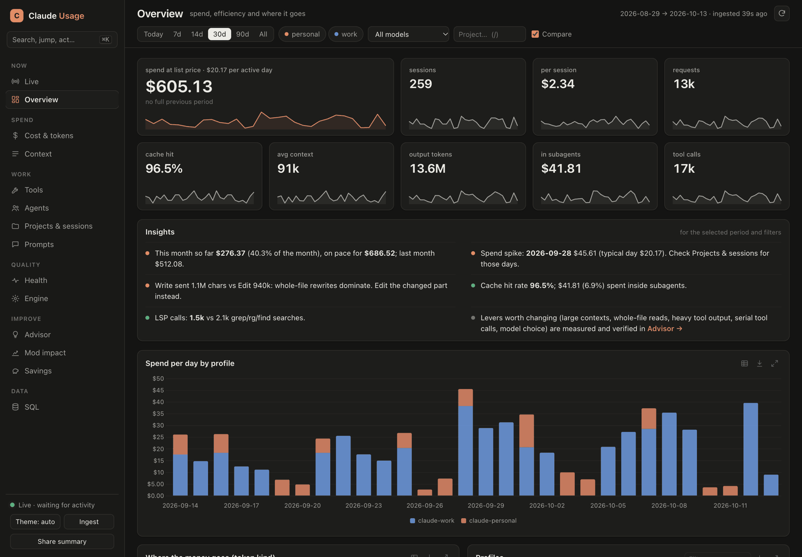
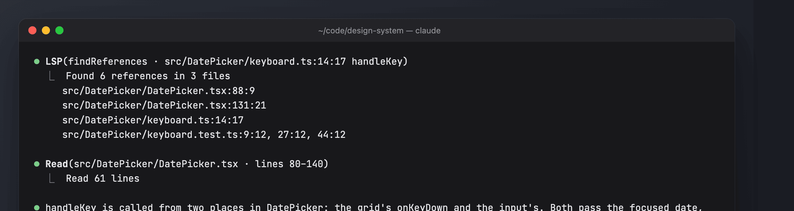
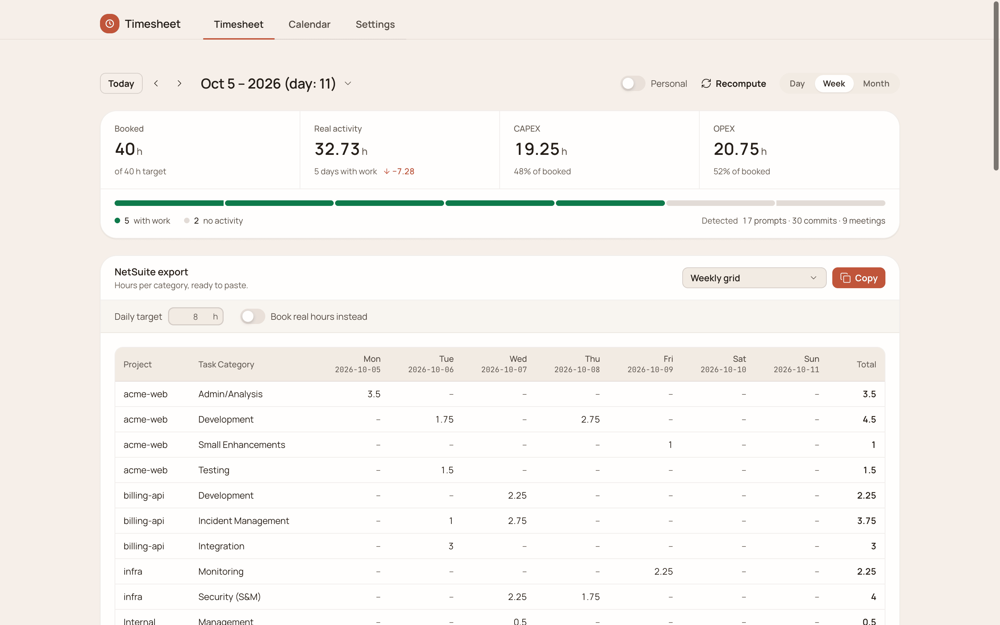
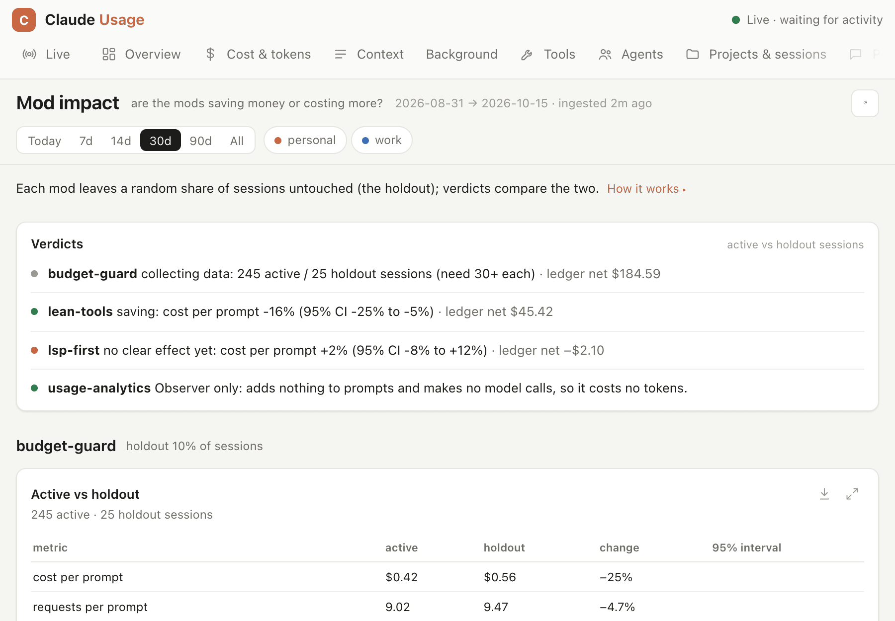
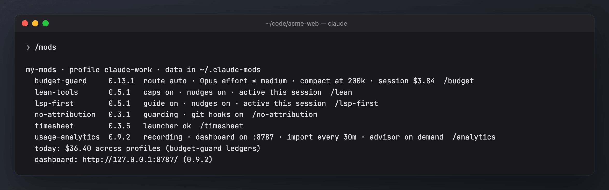
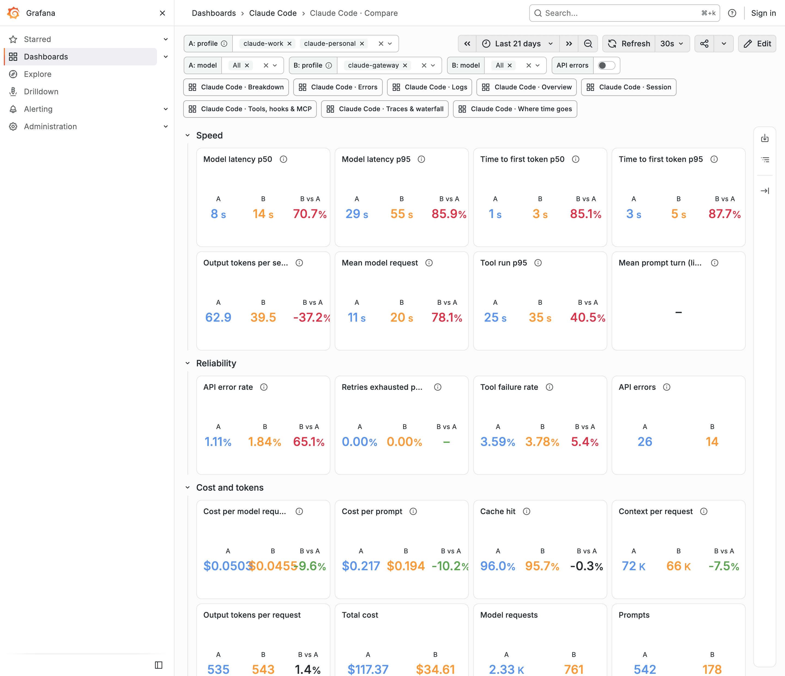
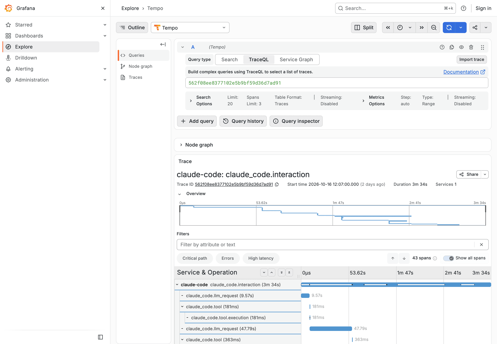

# claude-mods

Claude Code mods (function-hook plugins), shipped as the marketplace **`my-mods`**. They work with a single `~/.claude` setup and with several profiles (`CLAUDE_CONFIG_DIR=~/.claude-work`, `~/.claude-personal`, …).

| Mod | What it does | Doc |
| --- | --- | --- |
| **usage-analytics** | Logs every session, folds every profile's transcripts (including history from before the install) into one SQLite DB, `/analytics` reports and a live web dashboard | [docs/usage-analytics.md](docs/usage-analytics.md) |
| **budget-guard** | Live spend/context band, model and subagent routing, context hold, budgets, output trimming, keep-alive, savings ledger, `/budget` | [docs/budget-guard.md](docs/budget-guard.md) |
| **lean-tools** | Caps huge shell output, bounds `git log`, nudges toward batched calls, ranged reads and Edit over Write | [docs/lean-tools.md](docs/lean-tools.md) |
| **lsp-first** | Keeps the LSP tool loaded and tells the model to use it for code symbols instead of grep + Read | [docs/lsp-first.md](docs/lsp-first.md) |
| **no-attribution** | Claude never credits itself: engine attribution off, a prompt rule, tool calls with attribution refused, optional global git hooks | [docs/no-attribution.md](docs/no-attribution.md) |
| **timesheet** | NetSuite-ready timesheets from your sessions, git, GitHub and Google Calendar: the `timesheet` CLI, a web app, a skill and `/timesheet` | [docs/timesheet.md](docs/timesheet.md) |
| **observability** | Free, local Grafana for every profile, fed by Claude Code's own OpenTelemetry: trace waterfalls, logs, metrics, where time goes, errors, tools, a per-operation breakdown and an A/B compare of profiles (e.g. subscription vs LiteLLM); `/obs` (needs Docker) | [docs/observability.md](docs/observability.md) |
| *`/mods`* | One place for all of them: status, a combined setup, doctor, what changed, pause, update, install, uninstall | [docs/mods.md](docs/mods.md) |
| *Mod impact* | Each mod leaves a random holdout of sessions untouched; `/analytics impact` says whether it saves money or costs more | [docs/mod-impact.md](docs/mod-impact.md) |



| | |
| --- | --- |
|  **budget-guard**: spend, context, subagents and savings above the prompt |  **timesheet**: a NetSuite-ready week from your sessions and commits |
|  **Mod impact**: each mod against its holdout |  **`/mods`**: every mod's state in one place |
|  **observability**: subscription against LiteLLM, every figure as A, B and the difference |  **observability**: every prompt as a trace waterfall, subagents included |

The screenshots use generated demo data ([scripts/demo](scripts/demo/README.md)).

## Install

Requires Claude Code with mod support, **python3** (standard library only) for usage-analytics and **Node 22.18+** for timesheet and **Docker** (any free runtime, such as colima or OrbStack) for observability. The installer says how to get either when it is missing.

One command adds every mod to every Claude Code profile on this machine (`~/.claude`, each `~/.claude-*` config folder, `$CLAUDE_CONFIG_DIR`):

```sh
git clone https://github.com/nbotond20/claude-mods && sh claude-mods/bin/mods install
```

In a terminal it lists the mods and asks which to install; press Enter for all of them, or type numbers or names (`1,3`, `lean-tools timesheet`). To skip the question:

```sh
sh claude-mods/bin/mods install --yes                                   # all mods
sh claude-mods/bin/mods install --only usage-analytics,budget-guard     # just these
sh claude-mods/bin/mods install --except timesheet                      # all but these
sh claude-mods/bin/mods install --profiles ~/.claude-work               # just some profiles
```

Run it again to add a mod later; it skips what a profile already has. `/mods install <mod…>` does the same from a session.

Or by hand, per profile:

```
/plugin marketplace add nbotond20/claude-mods
/plugin install usage-analytics@my-mods
/plugin install budget-guard@my-mods        # and any of: lean-tools, lsp-first, no-attribution, timesheet, observability
```

Start a new session. One toast lists what is on; `/mods setup` walks through every mod's wizard in one go, and `/mods doctor` checks python3, Node, the dashboard, git hooks, the language server and whether every profile runs the same versions. Each wizard also runs on its own; it asks a few questions and writes the config:

| Wizard | Asks about |
| --- | --- |
| `/analytics setup` | which profiles to track, whether to keep prompt text, when the dashboard runs (with Claude Code, also from login, or only on `/dashboard`) |
| `/budget setup` | daily/monthly limits for this profile, model routing, the Opus effort cap, where to compact, when to hold large-context prompts |
| `/lean setup` | output caps and nudges |
| `/lsp-first setup` | whether the language server is installed, guide and nudges |
| `/no-attribution setup` | whether to install the global git hooks |
| `/timesheet setup` | the timesheet wizard (browser or terminal), Google Calendar, GitHub, work scope |
| `/obs setup` | whether to keep prompt text, which profiles report, replaying past sessions |

### On by default

Every mod works with no setup; the wizards only change defaults. Right after install:

| Mod | On by default | Off until you turn it on |
| --- | --- | --- |
| **usage-analytics** | records every session (prompt text included), imports every profile's history, a dashboard on `127.0.0.1:8787` started with Claude Code, a weekly digest toast, LiteLLM gateway spend sync when a gateway is set | dashboard at login (`claude-usage autostart on`), advisor research (`/analytics advise`) |
| **budget-guard** | the spend/context band, model routing by task (Haiku/Sonnet/Opus), Opus effort capped at medium, compaction at 200k, subagent cap 3, context warning at 150k and hold at 300k, build/test output trim, image and generated-file read guards | daily/monthly budgets (`/budget setup`); keep-alive and gateway polling only apply behind a LiteLLM gateway |
| **lean-tools** | Bash output cap (24 KB / 400 lines), `git log -n 30`, a short prompt guide, batching/ranged-read/Edit nudges | – |
| **lsp-first** | LSP tool loaded up front, a navigation guide, a grep-for-symbol nudge (at most every 10 min) | everything, if no language server plugin is installed |
| **no-attribution** | engine attribution off, the prompt rule, refusing tool calls with attribution, global git hooks (unless a global `core.hooksPath` is already set) | – (`/no-attribution hooks off` removes the hooks) |
| **timesheet** | the `~/.local/bin/timesheet` launcher, a weekly toast about last week; reports read Claude Code, OpenCode and git and classify with `claude -p` | work scope (nothing is booked until set), Google Calendar, GitHub, Redmine/NetSuite submission, the web app (`/timesheet open`) |
| **observability** | telemetry (prompt text included) written into every profile's settings from the next session, the Grafana stack on `127.0.0.1:3301` started with Claude Code when Docker runs, 90-day retention | full tool outputs (`toolContent`), replaying history (`claude-obs backfill`) |

Holdout is on too: budget-guard leaves 10% of sessions without its cost levers, lean-tools and lsp-first 20%, so `/analytics impact` can measure them ([mod-impact.md](docs/mod-impact.md)). Each mod's doc has the full table and how to change each item.

On first start usage-analytics starts the dashboard server and imports every transcript already on disk in the background; the dashboard shows the progress and fills in as it goes.

### Several profiles

`bin/mods install` covers every profile; `/mods install` does the same from a session. Each config dir keeps its own plugin cache. All profiles share one data folder, so the dashboard shows them together and per profile. Every session registers its config dir, so usage-analytics also finds profiles outside `~/.claude*`; `profileDirs` in its config (or `/analytics setup`) lists them explicitly.

### Updating

`/mods update` (or `sh bin/mods update`) refreshes the marketplace and updates every installed mod in every profile. After an update the next session's toast names what changed (`/mods changes` has the full list), and it warns when profiles run different versions. A running dashboard server older than the installed mod is replaced at the next session start.

### Pausing and removing

`/mods pause 2h` (or `30m`, `1d`) pauses every mod that changes what Claude does (budget-guard's routing and caps, lean-tools, lsp-first); budgets, analytics and no-attribution keep running. `/mods resume` ends it. Each mod pauses on its own too: `/lean off 1h`, `/lsp-first off session`, `/budget pause 2h`.

`/mods uninstall` shows what it would do; `/mods uninstall confirm` stops the dashboard and its login autostart, unsets no-attribution's global git hooks, removes timesheet's launcher and uninstalls the mods from every profile. `purge` also deletes the mods home (the usage database and configs). The same from a shell: `sh bin/mods uninstall [--purge] [--dry-run]`.

## Commands

| Command | Does |
| --- | --- |
| `/mods [status\|setup\|doctor\|changes\|pause <d>\|resume\|update\|install\|uninstall]` | all mods at once (see [docs/mods.md](docs/mods.md)) |
| `/dashboard [tab]` | opens the dashboard, e.g. `/dashboard live`, `/dashboard impact`. One server per machine; it is started on demand and updates live as you work. |
| `/analytics setup` · `status` · `ingest` · `stop` | setup wizard · data status · fold in new data now · stop the dashboard |
| `/analytics advise` · `advise bg` · `advise apply <id>` · `advise trial <id>` · `advise reproduce <id>` | research how to use Claude cheaper, leaner, faster and more reliably, from your own data, with every claim backed by a re-runnable query; apply a recommendation, or A/B-trial it on a random half of sessions; each one is measured (randomized, controlled, or before/after with a placebo check), graded A–D and gets a verdict (helped, backfired, no effect) that anyone can reproduce |
| `/analytics recurring` · `recurring classify [bg]` · `recurring automated\|dismiss <id>` | the prompts you keep typing, found without a model; a model then names each and drafts a skill, hook, command or CLAUDE.md rule; mark one automated and the tab shows whether it stopped |
| `/analytics impact` | are the mods saving money or costing more |
| `/analytics digest` · `summary [--days N] [--format html] [--no-projects]` | last week against the week before (also a toast once a week) · a shareable summary file (the dashboard's Share summary button makes the same page) |
| `/analytics [report] [--days N] [--profile P]` | terminal reports |
| `/budget …` · `/budget setup` | budget-guard (see its doc) |
| `/lean [setup\|status\|on\|off\|holdout <0-1>\|cap\|nudges\|guide on\|off]` | lean-tools |
| `/lsp-first [setup\|status\|on\|off\|holdout <0-1>\|nudges\|guide on\|off]` | lsp-first |
| `/no-attribution [setup\|status\|hooks on\|off]` | no-attribution |
| `/timesheet [week last\|day\|month\|setup\|doctor\|open\|status\|install\|…]` | timesheet: reports through the skill, the web app, setup and checks |
| `/obs [status\|open [dashboard]\|up\|down\|backfill\|telemetry on\|off [all]\|content on\|off\|setup]` | observability: the local Grafana stack and each profile's telemetry |

The CLI behind usage-analytics is `<plugin>/bin/claude-usage` (`claude-usage --help`); `claude-usage autostart on` also keeps the dashboard running from login (launchd on macOS, systemd on Linux).

## Where data lives

Everything the mods keep goes in one **mods home**, shared by every profile:

1. `$CLAUDE_MODS_HOME`, if set;
2. else `~/.claude-shared`, if it already exists (older installs keep working);
3. else `~/.claude-mods`.

```
<mods home>/
  usage-analytics/ config.json, usage.db, events/<profile>/<day>/*.jsonl, profiles/, live/, pricing.json, dashboard.log
  budget-guard/    config.json, budgets.json, key-baselines.json, sessions/<profile>-<session>.json
  lean-tools/      config.json
  lsp-first/       config.json
  no-attribution/  config.json, git-hooks/      ← global core.hooksPath when gitHooks is on
  timesheet/       entry                        ← the plugin version ~/.local/bin/timesheet runs
  observability/   config.json, admin-password, backfill.json, stack/, data/   ← the Grafana stack's config and its Loki/Tempo/Prometheus data
  mods/            installed/<profile>/<mod>.json, pause.json   ← what /mods reads
```

`CLAUDE_USAGE_DIR` overrides the usage-analytics folder alone. timesheet keeps its own data in `~/.timesheet` (`TIMESHEET_HOME`) and its tokens in the OS keychain.

## Developing

```
.claude-plugin/marketplace.json            ← lists the mods
<mod>/.claude-plugin/plugin.json           ← name, version, description
<mod>/hooks/hooks.json → hooks/register.ts(x)
<mod>/tests/*.test.ts
<mod>/CHANGELOG.md                         ← "## x.y.z" + bullets; the first bullet is the update toast
shared/mods-hub.ts                         ← the /mods block, copied into every hooks module
bin/mods                                   ← install/update/uninstall, copied to <mod>/bin/mods
scripts/sync-shared.sh · scripts/check.sh
docs/
```

```sh
claude --plugin-dir ./<mod>       # run a mod without installing it
claude plugin validate <mod>      # manifest + what the engine would refuse
claude plugin test <mod>          # tests/*.test.ts
sh scripts/sync-shared.sh         # after editing shared/mods-hub.ts or bin/mods
sh scripts/check.sh               # shared copies in sync, versions bumped, changelog and marketplace up to date
python3 -m unittest discover -s usage-analytics/tests -p 'test_*.py'
(cd timesheet && npm ci && npm test)
```

After a change, **bump the mod's `version`** and add a `## <version>` section to its CHANGELOG.md: `plugin update` only copies a new cache when the version changes, and `scripts/check.sh` (run by CI on every push and pull request) fails otherwise. The marketplace entry's version and description must match plugin.json.

## Secrets

None of the mods store credentials. usage-analytics records only *whether* an auth token is set and the gateway **hostname**, and blanks anything that looks like a credential in commands and output before writing it; its tests check that no secret ends up in the log.
