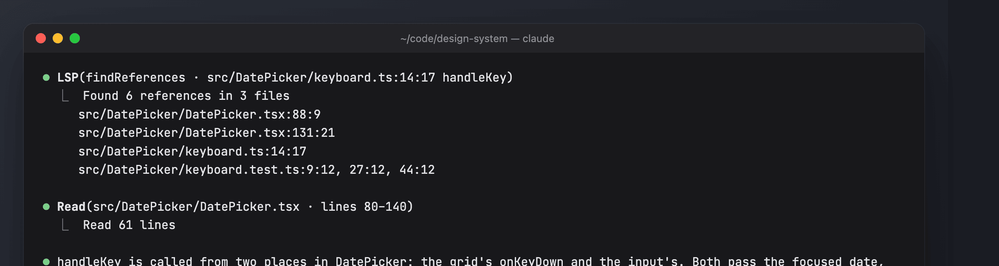
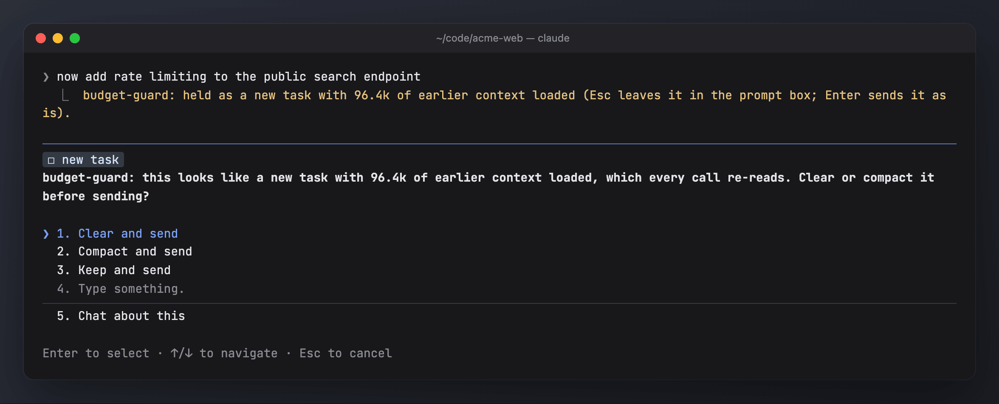
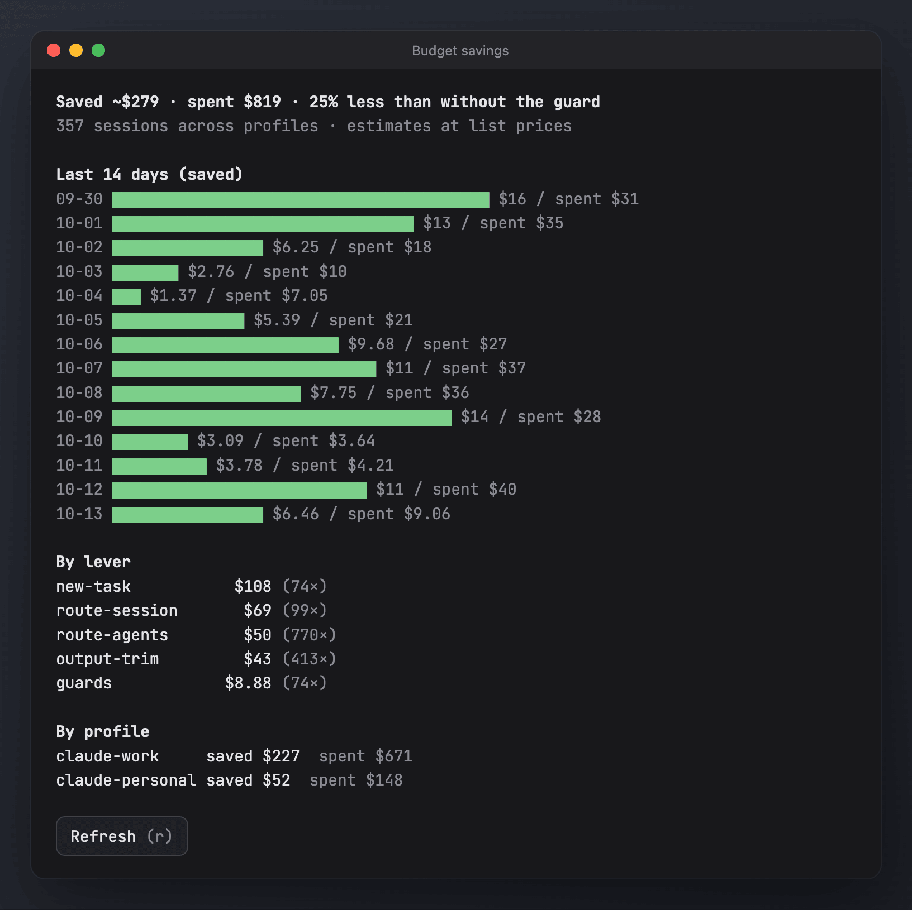

# budget-guard

Keeps spend and context in view and moves work to cheaper models where that is safe. A band above the prompt shows what the session costs, the day and month budgets, the plan limits or LiteLLM key spend, the context and the live subagents. The levers behind it route each session and subagent to the cheapest model that fits, trim noisy build output and hold prompts that would drag a huge context along.

- **The band:** model and effort, session cost and burn rate, budget gauges, either the 5h/7d plan limits or LiteLLM key spend (`+$` this session, 24h, 7d, `$/h`), context with the last turn's growth, live subagents and background tasks.
- **Session routing:** Haiku sorts the first prompt as trivial, quick, small, normal or hard and picks Haiku, Sonnet or Opus to match. Later prompts only move a session up.
- **Subagent routing and cap:** Explore and guide agents run on Haiku and the rest on Sonnet; at most 3 running at the same time.
- **Context control:** compaction at 200k, a warning at 150k, prompts held at 300k (the prompt goes back into the box), and a new-task check that offers clear, compact or keep when a new task arrives with 60k+ already loaded.
- **Leaner tool output:** noisy build/test commands keep their last 300 lines, with the full log on disk. Image reads and generated or vendored files are refused; interactively you are asked first (allow once, this turn, this session, or deny).
- **Opus effort cap** (`medium`), keep-alive pings on gateway profiles, and soft daily/monthly budgets.
- **Measured:** a savings ledger per lever (`/budget savings`), and 10% of sessions are a holdout so `/analytics impact` can say whether it pays off.



| | |
| --- | --- |
|  **New-task check**: clear, compact or keep |  **Savings**: what each lever saved |

The screenshots use generated demo data ([scripts/demo](../scripts/demo/README.md)).

## Install

```sh
sh bin/mods install --only budget-guard     # every profile on this machine; or, in Claude Code:
/plugin install budget-guard@my-mods
```

Everything is on after install. `/budget setup` sets budgets and the starting values.

## Commands

| Command | Effect |
| --- | --- |
| `/budget` | status |
| `/budget setup` | wizard: spending limits, routing, Opus effort cap, compaction, context hold |
| `/budget savings` | the savings pane |
| `/budget route opus\|sonnet\|haiku\|auto\|off` | pin a model, or turn routing on or off |
| `/budget daily\|monthly <$\|off>` | soft budget for this profile (gauge and toasts, never blocking) |
| `/budget warn\|block\|agents\|bigturn\|newtask <n>` | session limits, e.g. `/budget block 250k` |
| `/budget images\|keepalive\|trim\|agentroute on\|off` | switches a lever |
| `... --save` | a limit or switch set above lasts until `/clear` or the session ends; `--save` keeps it for new sessions |
| `/budget compact <n>\|off` | compact at n tokens (default 200k) |
| `/budget pause <30m\|2h\|1d\|session>` · `/budget resume` | the cost levers, effort cap and compaction step aside |
| `/budget holdout <0-1>` · `reset` · `refresh` | holdout share · session limits back to defaults · re-read LiteLLM spend |

## Config

`<mods home>/budget-guard/config.json`: `holdout` (0.1), `opusMaxEffort` (`medium`), `compactAt` (200000), `litellm` (`auto`) and `limits`, the starting session limits: `warn 150k · block 300k · maxAgents 3 · bigTurn 50k · newTaskAt 60k · allowImages off · route · routeAgents · keepAlive · trimOutput`. Budgets are in `budgets.json`.

Full documentation: [docs/budget-guard.md](../docs/budget-guard.md).
