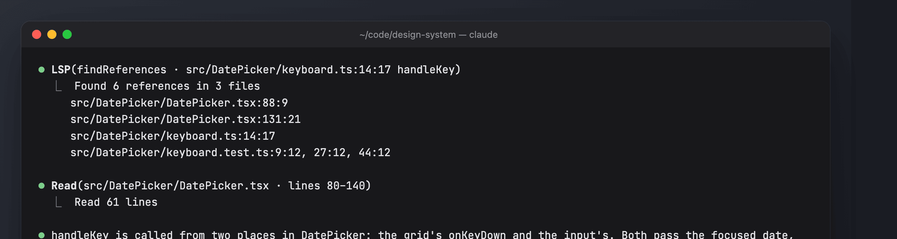
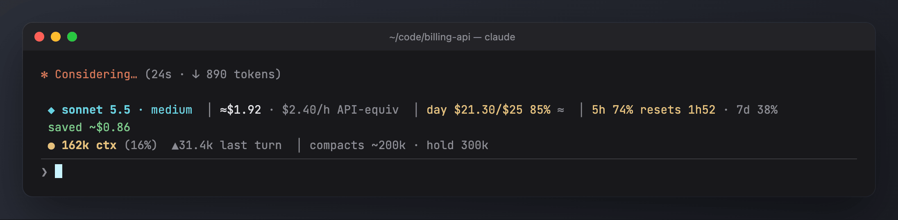
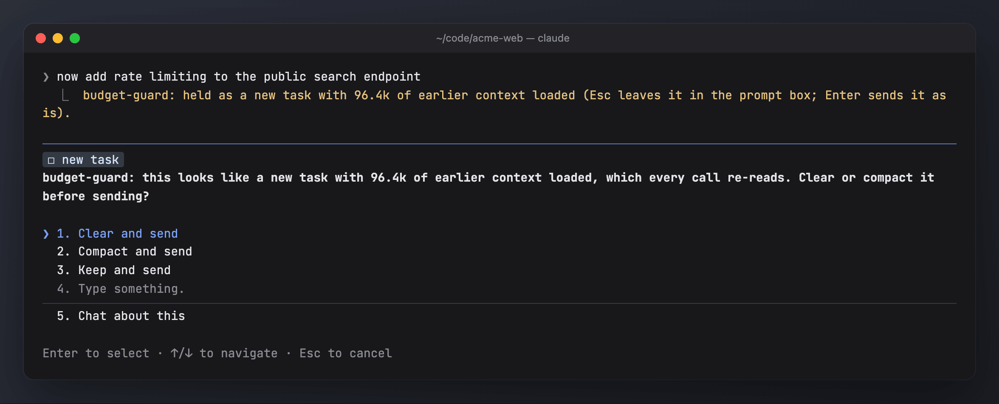
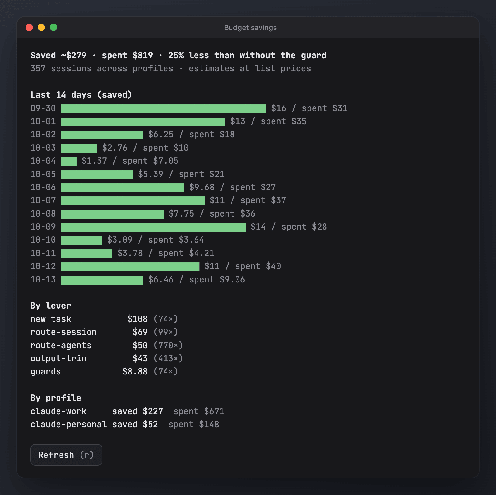

# budget-guard

Keeps spend and context visible and pushes work to cheaper models where that is safe. Source: `budget-guard/hooks/register.tsx`. The state contract is in `budget-guard/types/index.d.ts`.

## What you see



The screenshots use generated demo data ([scripts/demo](../scripts/demo/README.md)).

On a Claude subscription the money is API-equivalent (`≈`) and the plan's 5-hour and 7-day limits take the LiteLLM part's place. Here the day gauge is past 80% and the context past `warn`, so both are yellow:



**The band above the prompt** (`ui.render AbovePrompt`):
- the main model and effort;
- session cost and burn rate ($/h over the last 20 minutes);
- gauges for the daily and monthly budgets;
- either LiteLLM key spend (gateway profiles) or the 5h/7d plan limits;
  on a gateway the band reads `LiteLLM +$a · 24h $b · 7d $c · key $d/h`:
  - `+$a` is how much the key's total grew during this session;
  - `24h` and `7d` match LiteLLM's UI ("Last 24 hours", "Last 7 days"), which counts whole synced days only: `24h` is yesterday's spend and `7d` the six days before today, both from LiteLLM's per-day spend. Today's spend is in `+$a` and the day gauge;
  - `key $d/h` is the key's burn rate over the last 20 minutes. It counts every session and tool using that key, not only this one;
  on a subscription the 5h limit shows `full in ~Xh` when the current burn rate would use it up before it resets, else `resets in X`, plus the 7d percentage; on a plain API key the band says `API key, billed per token`;
- context tokens and the share of the window, the change in the last turn (`▲`/`▼`, yellow past `bigTurn`), and `compacts ~200k · hold 300k`: the mod's `compactAt` (or `autoCompactWindow` when that is lower) and the `block` limit;
- live subagents with the model each one actually runs on, and background tasks.

When a new-task prompt is held, the band shows the choice `[c] clear · [k] compact · [y] keep`.



**Toasts**:
- context over `warn` (consider /compact);
- a session moved up to a stronger model (see Session routing);
- the context was compacted at `compactAt`, or auto-compact was turned back on;
- keep-alive turned itself off for the session;
- a heavy turn (context grew by more than `bigTurn`);
- a tool result over about 30k chars;
- every 10th screenshot;
- budgets at 80% and at 100%.

**Savings pane** (`/budget savings`, pane id `budget-savings`): the estimated dollars each lever saved, for this session and across all sessions. The same ledgers feed the dashboard's [Savings tab](usage-analytics.md#a-tour-of-the-dashboard).



## Install

```sh
sh bin/mods install --only budget-guard     # every profile on this machine; or, in Claude Code:
/plugin install budget-guard@my-mods
```

## What it does

| Lever | Behaviour | Ledger category |
| --- | --- | --- |
| **Session routing** | On the first prompt of a session, Haiku sorts it as *trivial*, *quick*, *small*, *normal* or *hard*. Trivial (run a command, open a file, a one-line answer) runs on Haiku 5.5 at low effort; quick (questions, lookups) on Sonnet 5.5 at low; small (a well-defined change in one or two files) on Sonnet 5.5 at medium; normal and hard on Opus 5.5 at medium. Later prompts only move a session up, with a toast: implementation verbs or go-aheads ("implement it", "do it", "lgtm", a few Hungarian ones) take a trivial or quick session to Opus for free, unless the prompt is a plain question. Otherwise a prompt of at least 40 characters (trivial) or 200 (quick, small) is re-ranked by Haiku and moves up only if the tier is higher. This applies only while the session model is Opus. `/budget route opus\|sonnet\|haiku` pins the choice. | `route-session` |
| **Opus effort cap** | Every Opus request, main loop and subagents, is capped at `opusMaxEffort` (default `medium`). A rule: it applies in holdout sessions too. | (none) |
| **Compaction at `compactAt`** | When a turn ends with the context at or over `compactAt` (default 200k), the conversation is compacted before the next prompt, whatever `autoCompactWindow` says. Each session also switches the engine's auto-compact back on if it was turned off. A rule: it applies in holdout sessions too. `/budget compact off` leaves compaction to the engine. | (none) |
| **Subagent routing** | `Explore`, `claude-code-guide` and `statusline-setup` run on Haiku. `fork` keeps its model. Every other subagent runs on Sonnet. Engine forks (compaction, memory) are left alone. | `route-agents` |
| **Subagent cap** | At most `maxAgents` (default 3) subagents running at the same time; a further Agent call is denied with a message until one finishes. | (not counted) |
| **New-task check** | With at least `newTaskAt` (default 60k) of context loaded, a substantial prompt that Haiku judges to be a new task is held. You then choose clear, compact or keep. | `new-task` |
| **Context hold** | At `block` (default 300k) prompts are held until you /compact or /clear. Prefix a prompt with `force:` to send it anyway. | (none) |
| **Read guards** | Reads of images are denied (unless `/budget images on`), as are reads of generated or vendored files: `node_modules`, `dist`, `build`, `.next`, `coverage`, lockfiles, `*.min.*`, `*.map`, `*.log`. | (not counted) |
| **Build/test output trim** | Noisy commands keep only their last 300 lines in context; the full log goes to `$TMPDIR/budget-guard.XXXXXX`. Noisy means npm/pnpm/yarn/bun run test/build/lint/typecheck/check/e2e, jest, vitest, playwright test, tsc, eslint, biome, next build, pytest, mvn, gradle, go test/build/vet, cargo test/build/clippy, docker build and compose up/logs/build. Commands with a pipe or redirect, `head`/`tail`, or in the background are left alone. | `output-trim` |
| **Keep-alive** | On gateway profiles only, one tiny fork ping after 270s idle (with at least 30k of context) keeps the prompt cache warm for another 5 minutes. It turns itself off if a ping misses the cache. A saving is counted only when you are back while that cache is still warm. | `keep-alive` |
| **Spend polling** | On gateway profiles, it reads LiteLLM `/key/info` every 60s for key spend, max budget and reset time. | (none) |

## On by default

Right after install, with no setup (`/budget setup` is optional and only changes the starting values):

| Feature | Default | How to change |
| --- | --- | --- |
| Band, toasts, savings ledger | on | no switch |
| Session routing | on (`route`) | `/budget route auto\|off\|opus\|sonnet\|haiku`; `limits.route` in config.json for new sessions |
| Opus effort cap | `medium` (`opusMaxEffort`) | config.json, or `/budget setup`; `max` means no cap |
| Compaction | at 200k (`compactAt`), engine auto-compact forced back on | `/budget compact <n>\|off` |
| Subagent routing | on (`routeAgents`) | `/budget agentroute on\|off` |
| Subagent cap | 3 running at once (`maxAgents`) | `/budget agents <n>` |
| New-task check | at 60k context (`newTaskAt`) | `/budget newtask <n>` |
| Context warning / hold | warn 150k, hold 300k (`warn`, `block`) | `/budget warn\|block <n>` |
| Heavy-turn toast | +50k tokens in one turn (`bigTurn`) | `/budget bigturn <n>` |
| Image read guard | images denied (`allowImages` off) | `/budget images on` |
| Generated-file read guard | on | no switch |
| Build/test output trim | on (`trimOutput`) | `/budget trim on\|off` |
| Keep-alive | on, gateway profiles only (`keepAlive`) | `/budget keepalive on\|off` |
| LiteLLM spend polling | `auto`, gateway profiles only | `litellm` in config.json |
| Daily / monthly budgets | none (no gauges until set) | `/budget daily\|monthly <$>` or `/budget setup` |
| Holdout | 10% of sessions run without the cost levers | `/budget holdout <0-1>` |

lean-tools works alongside this. It caps *other* large shell output and leaves budget-guard's noisy commands to budget-guard.

## `/budget`

```
/budget                          status
/budget setup                    wizard: spending limits, routing, Opus effort cap, compaction, context hold
/budget savings                  savings pane (or a text summary)
/budget route opus|sonnet|haiku|auto|off    pin a model, or turn routing on (auto) or off
/budget daily|monthly <$|off>    soft per-profile budget (gauge and toasts, never blocking), saved to budgets.json
/budget warn|block|agents|bigturn|newtask <n>    e.g. /budget block 250k
/budget images|keepalive|trim|agentroute on|off
/budget reset                    session limits back to defaults
/budget refresh                  re-read LiteLLM spend now
/budget compact <n>|off          compact at n tokens of context (n at least 50k; default 200k), saved to config.json
/budget holdout <0-1>            share of sessions without the cost levers, for /analytics impact (default 0.1)
/budget pause <30m|2h|1d|session>   routing, the effort cap, compaction, trimming and keep-alive step aside
/budget resume                   ends a pause (so does its time running out)
```

While paused, the cost levers are off as in a holdout session (routing, subagent routing and cap, new-task check, image guard, trimming, keep-alive), and so are the effort cap and compaction. A pause keeps the budgets, the band, the generated-file guard and the context hold: it is for a stretch of work that needs Opus at full effort, not for turning the guard off. `/mods pause` pauses budget-guard with the other mods. budget-guard also takes part in `/mods status`, `setup`, `doctor` and `uninstall`.

Limits set with `/budget` last for the current session. Budgets, `compact` and `holdout` persist. To change the starting values of every session, put them under `limits` in config.json or run `/budget setup`.

**Turning it off or on.** There is no single off switch. `/budget pause` steps the cost levers aside for a while. For good, turn each lever off: `/budget route off`, `agentroute off`, `trim off`, `keepalive off`, `compact off`, `newtask`/`agents` raised, and `opusMaxEffort` `max`, saved as `limits` in config.json. `/mods uninstall` removes the mod. `/budget reset` puts the session limits back to the starting values.

## Defaults

Session limits (`limits` in config.json overrides them): `warn 150k · block 300k · maxAgents 3 · bigTurn 50k · newTaskAt 60k · allowImages off · route on · routeAgents on · keepAlive on · trimOutput on`. These are `DEFAULTS` in `register.tsx`. Config keys: `holdout 0.1 · opusMaxEffort medium · compactAt 200000 · litellm auto`.

## Files

| Path | Contents |
| --- | --- |
| `<mods home>/budget-guard/budgets.json` | `{ profiles: { "<profile>": { daily: 25, monthly: 500 } } }` (set by `/budget setup` or `/budget daily|monthly`) |
| `<mods home>/budget-guard/sessions/<profile>-<session>.json` | Per-session ledger: day, profile, spend, and savings by category. The dashboard's Savings tab reads these. |
| `<mods home>/budget-guard/config.json` | What every session starts from: `holdout` (0.1, see /budget holdout), `limits` (overrides of the defaults above, e.g. `{ "route": false, "block": 400000 }`), `opusMaxEffort` (`medium`; `max` means no cap), `compactAt` (200000; 0 leaves compaction to the engine), `litellm` (`auto`: poll LiteLLM key spend on a gateway and stop if it has no `/key/info`; `on` keeps trying; `off`). `/budget setup` writes it; the file is created with the defaults on first start. |
| `<mods home>/budget-guard/key-baselines.json` | LiteLLM key spend at period starts: the fallback for the daily and monthly gauges when the gateway has no `/user/daily/activity` (normally the gauges use LiteLLM's per-day spend). |
| `$TMPDIR/budget-guard.*` | Full logs of trimmed commands. |

`<mods home>` is `$CLAUDE_MODS_HOME` if set, else `~/.claude-shared` if that folder exists, else `~/.claude-mods`. The profile is the name of `$CLAUDE_CONFIG_DIR` (default `~/.claude`).

## Is it worth it?

A random 10% of sessions run in the **holdout** arm. The band, budgets, the effort cap, compaction at `compactAt` and the context hold stay on there, but routing, subagent routing and cap, trimming, keep-alive, the new-task check and the read guards are off. `/budget` shows the session's arm. `/analytics impact` compares the two arms and prices the Haiku classifier calls and keep-alive pings against the savings. See [mod-impact.md](mod-impact.md).

## Notes

- Savings are estimates: the cost of the same tokens on Opus minus the actual cost, or tokens kept out of context multiplied by about 10 future re-reads.
- The prices in `PRICE` are internal per-MTok weights used for those estimates. The analytics DB uses its own `pricing.json`.
