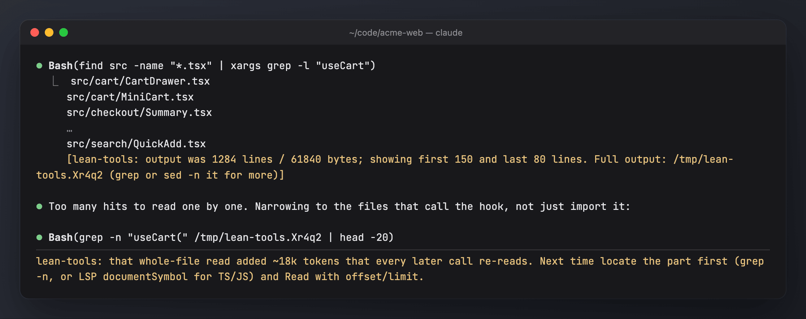

# lean-tools

Makes tool output smaller and round trips fewer. Every tool call re-sends the whole context, and every character a tool returns stays in context until compaction. In the last 30 days, cache reads were about 63% of spend, Bash produced about 68% of all tool output, and about 88% of requests made exactly one tool call.

Source: `lean-tools/hooks/register.ts`. Tests: `lean-tools/tests/`.



## What it does

| Hook | Behaviour |
| --- | --- |
| **Bash output cap** | Wraps the command. When output exceeds `maxBytes` (24k) or `maxLines` (400), the model sees the first 150 and last 80 lines plus a pointer to the full log in `$TMPDIR/lean-tools.XXXXXX`. Exit codes are preserved, and `cd`, env and heredocs keep working. |
| (cap exemptions) | Commands already bounded or risky to wrap are left alone: pipes to head/tail/less/more, redirects other than `2>&1`, heredocs, `sed -n`/`head`/`tail`/`awk`, `exit`/`exec`/`set -e`, bare `cd`/`export`/`source`, background runs, and noisy build/test commands (npm/pnpm/yarn/bun test/build/lint, jest, vitest, tsc, eslint, pytest, go/cargo test/build, docker build and similar), which budget-guard trims itself when it is installed. |
| **`git log` bound** | Adds `-n 30` to a command that starts with `git log` and has no count, range, date limit or pipe. |
| **System prompt section** `lean-tools:guide` | Five rules: batch independent calls; search, then do ranged reads; don't re-read; Edit over Write; keep command output small. |
| **Batching nudge** | After 4 main-loop turns in a row that each made one read-only call, a hidden note tells the model how many tokens each of those calls re-sent and asks it to parallelise. |
| **Big-read nudge** | A whole-file Read over 30k chars gets a note: next time, grep or LSP documentSymbol first, then Read with offset/limit. |
| **Re-read nudge** | Reading the same file whole again (over 2k chars), unedited, gets a note to reuse what is already in context. |
| **Write nudge** | A Write of over 3k chars to an existing file gets a note to use Edit. |

Each kind of nudge fires at most once every 10 minutes, so they cost almost nothing. In holdout sessions nothing is changed, wrapped or nudged; the mod only logs what it would have done.

## On by default

Everything is on after install, with no setup. `/lean setup` only asks about the same switches.

| Feature | Default | How to change |
| --- | --- | --- |
| Bash output cap | on (`capOutput`): over 24000 bytes or 400 lines | `/lean cap on\|off` |
| `git log` bound | on (`boundGitLog`): adds `-n 30` | config.json only |
| System prompt section | on (`guide`) | `/lean guide on\|off` |
| Nudges (batching, big read, re-read, write) | on (`nudges`); batching after 4 single read-only turns (`streak`), big read over 30000 chars (`bigRead`) | `/lean nudges on\|off` |
| Whole mod | on (`enabled`) | `/lean off` / `/lean on` |
| Holdout | 20% of sessions stay passive and only log | `/lean holdout <0-1>` |

## Managing it

| Command | Effect |
| --- | --- |
| `/lean` or `/lean status` | on/off/paused, this session's arm, settings, and this session's caps, re-opened logs, nudges and bounded `git log`s |
| `/lean setup` | wizard that writes config.json |
| `/lean off [30m\|2h\|1d\|session]` | with a duration, pauses caps, nudges and the guide for that long (a timed pause is shared by all sessions that use the same mods home; `session` is this session only). With no duration, sets `enabled` false until `/lean on` |
| `/lean on` | sets `enabled` true and ends any pause |
| `/lean holdout <0-1>` | share of sessions that stay passive (0 = never; applies from the next session) |
| `/lean cap\|nudges\|guide on\|off` | switch that part |

`/mods pause` pauses it together with the other mods. Changes to the settings apply from the next session.

## Config: `<mods home>/lean-tools/config.json`

The file is written with these defaults on first start:

```json
{ "enabled": true, "holdout": 0.2, "capOutput": true, "maxBytes": 24000, "maxLines": 400, "headLines": 150, "tailLines": 80,
  "boundGitLog": true, "nudges": true, "streak": 4, "bigRead": 30000, "guide": true }
```

Keys: `enabled` (false turns the mod off), `holdout` (share of passive sessions), `capOutput` (cap Bash output), `maxBytes` / `maxLines` (cap thresholds), `headLines` / `tailLines` (lines shown from the start and end of a capped output; each line cut to 400 chars), `boundGitLog`, `nudges`, `streak` (single read-only turns before the batching nudge), `bigRead` (chars a whole-file Read may return before the big-read nudge), `guide`. Set `capOutput`, `nudges` or `guide` to `false` to switch those parts off. Changes take effect at the next session start. The same switches are on `/lean` (above); `<mods home>` is `$CLAUDE_MODS_HOME` if set, else `~/.claude-shared` if it exists, else `~/.claude-mods`.

`holdout` is the share of sessions where lean-tools stays passive and only logs what it would have done; see [mod-impact.md](mod-impact.md).

## Measuring it

**`/analytics impact`** (or `/dashboard impact`) gives the holdout verdict, the cap savings against the guide and nudge costs, and how often each nudge is followed. In the dashboard:
- **Tools → Bash commands:** the `capped` column.
- **Tools → Read: whole vs ranged** and **Edit vs Write.**
- **Context → Tool calls per request.**
- **Cost & tokens → Efficiency per day.**

Compare the days before and after you installed it.
