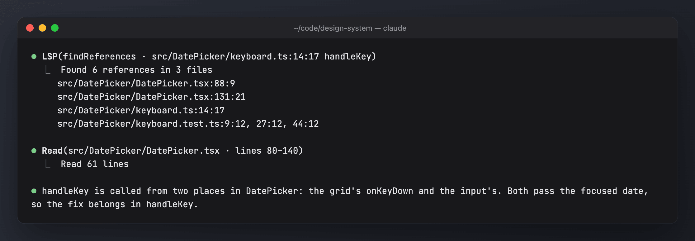

# lsp-first

Gets the model to use the language server for symbol questions instead of grepping and reading whole files. Without it the LSP tool is deferred and, in practice, rarely called (one setup measured 0 LSP calls against about 15k grep/rg/find searches).

Source: `lsp-first/hooks/register.ts`. Tests: `lsp-first/tests/`.



The screenshots use generated demo data ([scripts/demo](../scripts/demo/README.md)).

## What it does

1. **Keeps the LSP tool's schema in the prompt.** `tool.describe` with `isDeferred: false` puts it in the tool list instead of behind ToolSearch, so using it costs no extra round trip.
2. **Adds the system prompt section `lsp-first:guide`** whenever the LSP tool is present. It covers:
   - `goToDefinition` / `workspaceSymbol` for "where is X defined";
   - `findReferences` / `incomingCalls` / `outgoingCalls` for "who uses X";
   - `hover` for types and signatures;
   - `documentSymbol` for a file's outline;
   - `goToImplementation`.
   grep stays the tool for strings, comments, config and files that are not TS/JS.
3. **Nudges.** When a Bash `grep`/`rg`/`git grep`/`ag` (or a Grep tool, on builds that have one) searches TS/JS for a bare identifier, the result carries a one-line hint naming the LSP operation to use. This happens at most once every 10 minutes.

`/lsp-first off 1h` (or `30m`, `1d`, `session`) steps aside for that long; `/lsp-first on` resumes. `/mods pause` pauses it with the other mods.

## On by default

On after install, with no setup, provided an LSP tool exists (see below). Without a language server plugin nothing is changed.

| Feature | Default | How to change |
| --- | --- | --- |
| LSP schema up front (`upfront`) | on | config.json only |
| System prompt guide (`guide`) | on | `/lsp-first guide on\|off` |
| Nudges (`nudges`) | on, at most once every 10 minutes | `/lsp-first nudges on\|off` |
| Whole mod (`enabled`) | on | `/lsp-first off` / `/lsp-first on` |
| Holdout | 20% of sessions stay passive | `/lsp-first holdout <0-1>` |

## Managing it

| Command | Effect |
| --- | --- |
| `/lsp-first` or `/lsp-first status` | on/off/paused, this session's arm, settings, and this session's LSP calls, TS/JS symbol searches and nudges |
| `/lsp-first setup` | checks for the LSP tool, asks about the options and writes config.json |
| `/lsp-first off [30m\|2h\|1d\|session]` | with a duration, steps aside for that long (`session` is this session only). With no duration, sets `enabled` false until `/lsp-first on` |
| `/lsp-first on` | sets `enabled` true and ends any pause |
| `/lsp-first holdout <0-1>` | share of sessions that stay passive (0 = never; applies from the next session) |
| `/lsp-first nudges\|guide on\|off` | switch that part |

`/mods pause` pauses it with the other mods. Setting changes apply from the next session.

## The TypeScript language server

lsp-first needs a language server plugin; without one it does nothing. For TypeScript/JavaScript:

```sh
npm i -g typescript-language-server typescript
```
```
/plugin install typescript-lsp@claude-plugins-official
```

Check it with `typescript-language-server --version`. In a session, the LSP tool should appear in `/context` under tools that are not deferred. `/mods doctor` also checks for `typescript-language-server`.

## Config: `<mods home>/lsp-first/config.json`

Written with these defaults on first start (`<mods home>` is `$CLAUDE_MODS_HOME` if set, else `~/.claude-shared` if it exists, else `~/.claude-mods`):

```json
{ "enabled": true, "holdout": 0.2, "upfront": true, "guide": true, "nudges": true }
```

`enabled` false turns the mod off; `holdout` is the share of passive sessions; `upfront` keeps the LSP schema loaded instead of deferred; `guide` adds the system prompt section; `nudges` adds the grep hints. In holdout sessions LSP stays deferred, and no guide or nudges are added.

## Measuring it

**`/analytics impact`** compares sessions with and without lsp-first, prices the up-front schema and guide, and shows how often a nudge led to an LSP call. See [mod-impact.md](mod-impact.md). Also:

Use **Tools → LSP vs text search per day** and **LSP operations** in the dashboard, plus the Overview insight "LSP calls: N vs M grep/rg/find searches".
