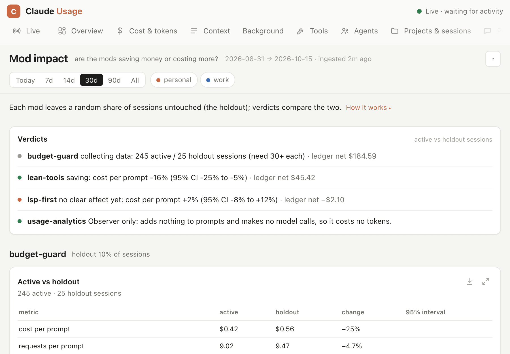

# Mod impact: are the mods saving money?

Every mod that changes what the model sees or does (budget-guard, lean-tools, lsp-first) is measured. usage-analytics observes. It adds nothing to prompts, except while you trial or adopt an advisor instruction: that instruction goes into the trial's 'on' sessions only, and the advisor measures it against the rest. It makes no model calls, except the advisor runs you start.

```
/analytics impact [--days N] [--profile P]     terminal report (ingests first)
/dashboard impact                              the "Mod impact" tab
claude-usage impact [--days N] [--profile P] [--json]   from a shell
```

`--days` defaults to 30 (0 is all time).



The screenshots use generated demo data ([scripts/demo](../scripts/demo/README.md)).

## On by default

| Feature | Default | How to change |
| --- | --- | --- |
| Holdout experiment | **on** for budget-guard (10% of sessions), lean-tools (20%) and lsp-first (20%): those sessions run with the mod passive | `holdout` per mod, see [Holdout settings](#holdout-settings) |
| Arm and action logging | on; the mods write events under usage-analytics' data folder, which needs usage-analytics to import them | n/a |
| Ledger and compliance | computed from the logged events, nothing to enable | n/a |
| Verdicts | wait for 30 sessions with prompts in each arm | n/a |
| no-attribution, usage-analytics | not measured (no holdout) | n/a |

## How it is measured

**1. Holdout (the causal answer).**
- At session start, each mod puts the session in an arm: `holdout` with probability `holdout`, otherwise `on`.
- The arm is a hash of mod + session id. It stays the same across reloads, and each mod draws its own, so the other mods are balanced across both arms.
- In the holdout the mod stays passive and logs `would_*` events: what it would have done.
- The report compares active and holdout sessions on four measures:
  - cost per prompt;
  - requests per prompt;
  - tool-output chars per prompt;
  - cost per request.
- Each comparison comes with a bootstrap 95% interval.

| Verdict | Meaning |
| --- | --- |
| collecting data | fewer than 30 sessions (with at least one prompt) in one of the arms |
| **saving X%** | cost per prompt is lower with the mod on, and the whole interval is below 0 |
| **COSTING MORE** | cost per prompt is higher with the mod on, and the whole interval is above 0 |
| no clear effect yet | the interval spans 0. With more sessions it narrows. |

Session costs vary a lot from one session to the next, so expect weeks of normal use before a verdict appears. Effects under about 10% may never show.

**2. Ledger (mechanical, active sessions only).** Each mod's own actions are priced with the analytics price table.

| | Item | How it is priced |
| --- | --- | --- |
| − | `lean-tools:guide` / `lsp-first:guide` system prompt sections, the LSP schema loaded up front | chars/4 tokens: one cache write, then a cache read on every later main-loop request |
| − | Nudge text | the same, until the next compaction |
| − | budget-guard's Haiku classifier calls | input chars/4 at Haiku prices |
| − | Keep-alive pings | their real usage, repriced |
| + | Output kept out of context (lean-tools cap, budget-guard trim) | the bytes avoided, carried the same way |
| + | Keep-alive pings that paid off | measured, not taken from budget-guard's estimate: an idle stretch of pings (each less than 5.5 minutes after the one before) counts only when the next main-loop request came within 5 minutes and read at least half the cache it kept warm. It is then worth what a cache write of those tokens would have cost over the cache read. |
| + | budget-guard's own route-session / route-agents / new-task estimates (its keep-alive and trim estimates are left out, they are measured above) | from its ledgers |

The savings side is an upper bound: without the cap the model might have piped through `head` itself. Trust the holdout verdict over the ledger.

**3. Compliance.** After each nudge, the next calls show whether the model did what it was asked.

| Nudge | Counts as followed |
| --- | --- |
| batch | the next steps used more than one tool per request |
| bigread | the next reads were ranged |
| reread | the next reads were not repeats |
| write | the next change used Edit instead of a Write over an existing file |
| lsp | LSP was used within 10 tool calls |

The same rate is computed in holdout sessions for the moments a nudge *would* have fired. If the two rates are equal, the nudge changes nothing and only costs tokens; the report warns about that.

**Warnings:**
- a nudge that is not changing behaviour;
- lean-tools caps that are re-opened often, so the cap is too tight;
- 5 or more budget-guard denials.
- budget-guard's keep-alive cost more than it saved (at least 3 idle stretches), with how many stretches ended in a cache read and how many ran every ping without one.

The lean-tools warning fires when more than 30% of at least 5 capped outputs were re-opened. The nudge warning needs 20 or more nudges in each arm and a follow rate that is no higher with the nudge.

## Events

Mods write to `<mods home>/usage-analytics/events/<profile>/<day>/<sid>.<ts>.<mod>-*.jsonl`. Each line has the form `{ts, ev:'mod', sid, profile, mod, kind, arm, ...}`. After ingest they are in the `events` table, and the `v_mod_actions` view shows them flattened.

| Mod | kinds |
| --- | --- |
| all | `arm` (with holdout share, version, settings), `session_summary` |
| lean-tools | `cap`/`would_cap`, `cap_followup`, `gitlog_bound`/`would_gitlog_bound`, `guide`, `nudge`/`would_nudge`, `nudge_outcome` |
| lsp-first | `schema_upfront`, `guide`, `lsp_call`, `symbol_search`, `nudge`/`would_nudge`, `nudge_outcome` |
| budget-guard | `classify`, `route`, `agent_route`, `reroute`, `hold`, `resolve`, `force`, `compact`, `deny`/`would_deny`, `trim`/`would_trim`, `keepalive` |

## Holdout settings

| Mod | Default | Change it |
| --- | --- | --- |
| budget-guard | 10% | `/budget holdout 0.1` |
| lean-tools | 20% | `/lean holdout 0.2` |
| lsp-first | 20% | `/lsp-first holdout 0.2` |

The value (0 to 1) is stored in each mod's `config.json` under `<mods home>/<mod>/` (`<mods home>` is `$CLAUDE_MODS_HOME`, else `~/.claude-shared` if it exists, else `~/.claude-mods`) and applies from the next session. Each mod's setup (`/mods setup`) asks about it. `0` turns the experiment off (always active); `1` makes the mod fully passive.

**What budget-guard's holdout switches off:** routing, subagent routing, output trimming, keep-alive, the new-task check, the subagent cap, the image block, the generated-file block and the effort cap. The band, the budgets and the context hold at `block` stay on in both arms.

## Code

- The analysis: `usage-analytics/bin/impact.py`, served at `/api/impact`.
- The tracking block (`trackStart` / `trackLog` / `trackFlush`, about 40 lines) is inlined into each mod's register file. The engine only lets `$` be passed to functions declared in the same file.
