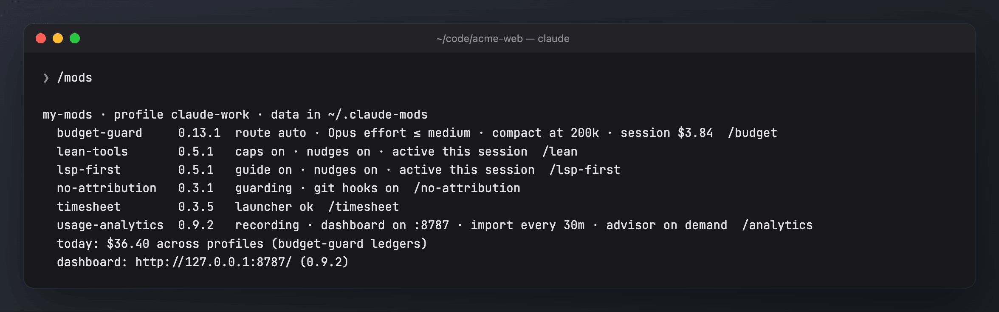
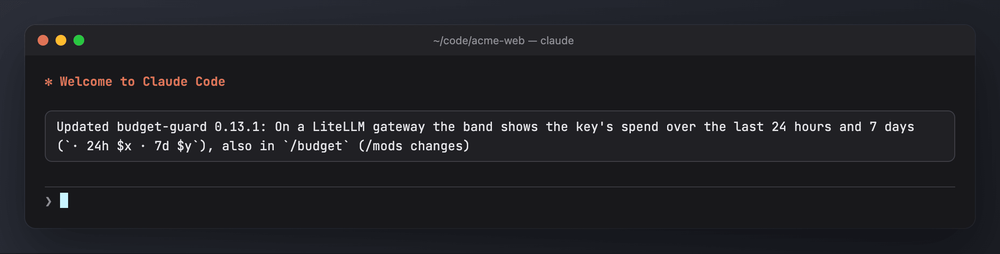

# /mods and bin/mods

Every mod carries the same small hub (`shared/mods-hub.ts`, copied into each `hooks/register.ts` by `scripts/sync-shared.sh`) and the same install script (`bin/mods`, copied to each mod's `bin/`). Together they install, check, pause, update and remove the mods as one set, in every Claude Code profile on the machine.

## Install, update, remove

```sh
git clone https://github.com/nbotond20/claude-mods
sh claude-mods/bin/mods install                       # asks which mods (Enter = all), every profile
sh claude-mods/bin/mods install --yes                 # all mods, no question
sh claude-mods/bin/mods install --only usage-analytics,lean-tools
sh claude-mods/bin/mods install --except timesheet
sh claude-mods/bin/mods install --profiles ~/.claude-work
sh claude-mods/bin/mods update                        # pull the marketplace, update each installed mod
sh claude-mods/bin/mods list                          # what each profile has
sh claude-mods/bin/mods uninstall --dry-run [--purge] # show what would go
sh claude-mods/bin/mods uninstall [--yes] [--purge]   # remove (alias: remove); --yes skips the prompt
```

The question only appears in a terminal; `--only`, `--except`, `--yes` or a non-interactive run (such as `/mods install`) install without asking, all mods unless narrowed. Names and list numbers both work.

Profiles are `~/.claude`, every `~/.claude-*` folder that looks like a config folder, `$CLAUDE_CONFIG_DIR`, and any profile a mod has recorded. Install checks for python3 (usage-analytics) and Node 22.18+ (timesheet) and says how to install what is missing; it never installs them itself. `MODS_SOURCE` points install and update at another marketplace (a local folder or `owner/repo`).

Uninstall stops the dashboard server, removes its login item and the no-attribution git hooks, removes the `timesheet` launcher when it is ours, and uninstalls the mods from every profile. The data folder (`<mods home>`: `$CLAUDE_MODS_HOME`, else `~/.claude-shared` when it exists, else `~/.claude-mods`) stays unless you pass `--purge`. `~/.timesheet` and the timesheet's keychain tokens are always kept.

## `/mods` inside Claude Code



| Command | What it does |
| --- | --- |
| `/mods` · `/mods status` | each mod with its version and a one-line state, plus profiles that run different versions |
| `/mods setup [mod…]` | one guided setup: asks which mods to tailor, then their questions together (every mod has one; `/<mod> setup` runs one alone) |
| `/mods doctor` | checks: python3, node, the dashboard, the `timesheet` launcher, an old timesheet skill copy shadowing the plugin's, version drift, the `claude` CLI |
| `/mods changes` | the latest CHANGELOG lines of each mod |
| `/mods pause <30m\|2h\|1d>` (a bare number is minutes) · `/mods resume` | budget-guard's levers, lean-tools and lsp-first step aside in every session (within 30 seconds). usage-analytics keeps recording; no-attribution keeps guarding |
| `/mods update` · `/mods install [mod…]` | run `bin/mods` from inside a session |
| `/mods uninstall [confirm] [purge]` | without `confirm` it only shows the plan |

Each mod's own pause (`/budget pause`, `/lean off 1h`, `/lsp-first off 1h`) writes the same file, `<mods home>/mods/pause.json`. Only a mod's own pause takes `session` (this session only); `/mods pause` needs a duration.

## On by default

Installing turns every mod on in every profile. `/mods setup` is optional: each mod runs on its defaults (see the *On by default* section of each mod's doc). Nothing is paused. The toast below runs at every session start.

## The session toast

At session start each mod records itself in `<mods home>/mods/installed/<profile>/<mod>.json`. The mod whose name sorts first then shows one toast for the whole set:

- first runs, with a pointer to `/mods setup`;
- updates, with the headline (first bullet) of each new version in the mod's `CHANGELOG.md`;
- profiles that run different versions of a mod (shown once per change; `/mods update` fixes it).



Where several installed mods carry the hub, the one with the newest hub answers `/mods`.
