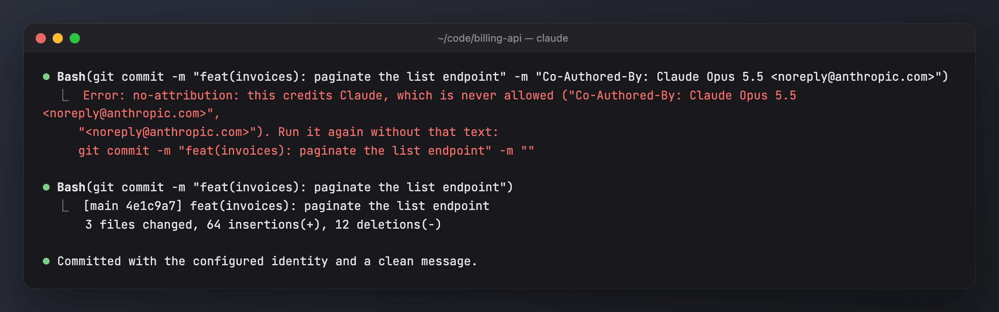
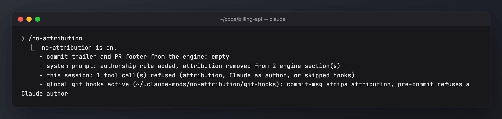

# no-attribution

Claude never credits itself. That means no `Co-Authored-By: Claude …`, no `🤖 Generated with [Claude Code](…)`, no `Author: Claude`, no `noreply@anthropic.com`, and no commits with Claude as author. This covers commits, PR and issue bodies, code, docs and any tool call. Source: `no-attribution/hooks/register.ts`; tests: `no-attribution/tests/`.

The screenshots use generated demo data ([scripts/demo](../scripts/demo/README.md)).

## On by default

Layers 2 to 4 are always on and cannot be turned off or paused (`/mods pause` does not affect them). Only the git hooks and the settings entry are optional.

| Feature | Default | How to change |
| --- | --- | --- |
| Empty engine commit trailer and PR footer (layer 2) | on | not switchable |
| Authorship rule in the system prompt, attribution stripped from engine sections and skill prompts (layer 3) | on | not switchable |
| Tool-call refusals: attribution, Claude as author, skipped hooks (layer 4) | on | not switchable |
| Global git hooks (layer 5) | **on**: installed at the first session start and re-checked at every one, unless another global `core.hooksPath` is already set (then left alone, with a toast) | `gitHooks` in config, `/no-attribution hooks off` |
| `attribution` / `includeCoAuthoredBy` entries in `settings.json` (layer 1) | not set by the mod | add them yourself |

## Layers

Each layer works on its own; together they cover each other's gaps.

| # | Where | What |
| --- | --- | --- |
| 1 | Your `settings.json` (optional, recommended) | `attribution: { commit: "", pr: "", sessionUrl: false }`, `includeCoAuthoredBy: false` |
| 2 | `attribution.text` | The engine's commit trailer and PR footer are returned empty, whatever the settings say. |
| 3 | `prompt.compose` / `skill.prompt` | Attribution lines are removed from the engine's system prompt sections and skill prompts. The section `no-attribution:rule` tells the model it is never an author, anywhere. |
| 4 | `tool.call` | Anything carrying attribution is **refused, never rewritten**, so what runs is exactly what you approved. The refusal names the offending text and, for Bash, gives the clean command, so the model sends it again. This covers Bash commands (heredoc commit messages, `-m`, `--body`, `--trailer`, …), the new text in Write/Edit/NotebookEdit (Edit's `old_string` may still contain it, which allows removing attribution), and every string argument of MCP tools such as a GitHub PR tool. **Also refused:** committing as Claude (`--author`, `GIT_AUTHOR_*`/`GIT_COMMITTER_*`, `git config user.name/email`) and skipping hooks (`--no-verify`, `git commit -n`, `-c core.hooksPath`, `git config core.hooksPath`). If the check itself fails, the call is refused, not let through. |
| 5 | Global git hooks, when `gitHooks` is on (`git config --global core.hooksPath <mods home>/no-attribution/git-hooks`) | **`commit-msg`** strips attribution lines from every commit message, whoever wrote it. **`pre-commit`** refuses a Claude/Anthropic author or committer. Every hook then runs the repository's own `.git/hooks/<name>`, so existing repo hooks keep working. |

What counts as attribution:
- trailers (`Co-Authored-By`, `Signed-off-by`, `Assisted-by`, `Generated-by`, `Written-by`, `Author`, …) that name Claude or Anthropic;
- phrases such as "generated / written / created / made / built … with / by / using Claude (Code)", with or without 🤖 and a link;
- any `noreply@anthropic.com`.

Ordinary mentions are kept, such as "Use the Claude API for summaries".

## Check it

`/no-attribution` shows:
- the layers;
- what was refused this session;
- whether the git hooks are active.

It also reinstalls the hooks if they are missing. They are installed again at every session start.

## Managing it

| Command | What it does |
| --- | --- |
| `/no-attribution` or `/no-attribution status` | shows the layers, what was refused this session, the git hook state; reinstalls the hooks when `gitHooks` is on |
| `/no-attribution setup` | asks whether to install the global git hooks and writes the config |
| `/no-attribution hooks on` | sets `gitHooks` true and installs the hooks |
| `/no-attribution hooks off` | sets `gitHooks` false and removes the global hooks (only if they are this mod's) |
| `sh no-attribution/bin/install-git-hooks.sh [remove]` | the installer behind the above; prints `installed`, `ok`, `other:<path>`, `removed` or `absent` |
| `/mods status`, `/mods doctor`, `/mods uninstall` | `doctor` checks the hooks; `uninstall` also unsets the hooks it installed |

There is no pause. To stop the mod, uninstall it (`/mods uninstall`); to turn off only the git layer, use `hooks off`.

### Config: `<mods home>/no-attribution/config.json`

| Key | Default | Meaning |
| --- | --- | --- |
| `gitHooks` | true | install the global git hooks (the global `core.hooksPath` setting) |

`<mods home>` is `$CLAUDE_MODS_HOME`, else `~/.claude-shared` if that folder exists (older installs), else `~/.claude-mods`. The hooks are copied to `<mods home>/no-attribution/git-hooks`. The config file is created on first run.

## Limits and notes

- A repository that sets its **own** `core.hooksPath` (Husky, lefthook) overrides the global one, so layer 5 does not run there. Layers 2–4 still apply to everything Claude does.
- If another global `core.hooksPath` is already set, the installer leaves it alone, and `/no-attribution` says so.
- Writes and edits to files whose path contains `no-attribution` are not refused, so this mod's own docs and source can quote the patterns.
- To remove the git layer: `git config --global --unset core.hooksPath`.
