# timesheet

NetSuite-ready timesheets from your Claude Code and OpenCode sessions, git and GitHub history and Google Calendar. The mod bundles the `timesheet` CLI and web app, the timesheet skill, and `/timesheet`. The full manual is [timesheet/README.md](../timesheet/README.md).

Needs Node 22.18 or newer (it uses `node:sqlite` and runs TypeScript directly).

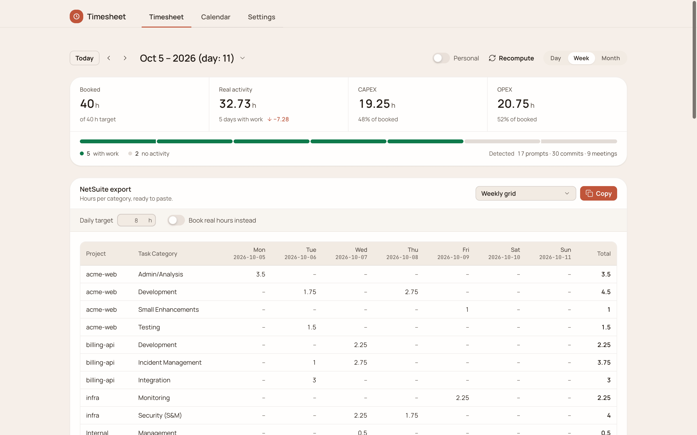

## What you get

- **Two figures per day.** *Real* is the time your sessions, commits and meetings actually cover. *Booked* is that time scaled to the daily target (8h by default) and rounded, which is what goes into NetSuite.
- **A task category for every hour.** A headless Claude call reads each day's time blocks: the prompts, the commits and what changed (code, tests, CI, infra, docs). It puts each block in one of your task categories and writes a short summary of the day. CAPEX or OPEX follows from the category. The call runs lean: no tools, MCP servers or skills and a one-line system prompt, about 3.5k tokens of context per day.
- **Hand edits that stick.** Override a category's hours, move a block to another category, or lock a day. Recomputes keep the edits, `timesheet history` lists them and `timesheet undo` reverts them.
- **Checks before you submit.** `timesheet review` flags a day booked far above what was recorded, a day not computed, or a repo with no scope. `submit plan` shows what would be entered in Redmine and NetSuite without writing anything.

## On by default

Installing the mod puts `~/.local/bin/timesheet` in place at the next session start and turns on the weekly toast below. Nothing is collected until you run a report. The CLI then reads Claude Code (every profile), OpenCode and git by default and classifies with `claude -p`. Work scope is empty until you set it, so nothing is booked yet. Google Calendar, GitHub and Redmine/NetSuite submission stay off until you connect them. The web app runs only after `/timesheet open` or `timesheet serve`. The full table is in [the manual](../timesheet/README.md#on-by-default).

## Commands

| Command | What it does |
| --- | --- |
| `/timesheet` · `/timesheet status` | target hours per day, whether calendar and GitHub are connected, launcher warnings |
| `/timesheet setup` | a guided setup through the skill |
| `/timesheet doctor` | the CLI's own checks |
| `/timesheet open` (also `serve`, `web`) | starts the web app on port 4280 (log: `<mods home>/timesheet/web.log`) and opens it. A running web app of this version or newer is reused, an older one is replaced, and anything else on the port is named (`TIMESHEET_PORT` picks another port) |
| `/timesheet day\|week\|month [date]` | the timesheet for that period, through the skill |
| `/timesheet <anything else>` | handed to the skill as a request |
| `/timesheet install [--force]` | (re)installs the `timesheet` launcher |

Without a config, `/timesheet setup` asks where to run the wizard:

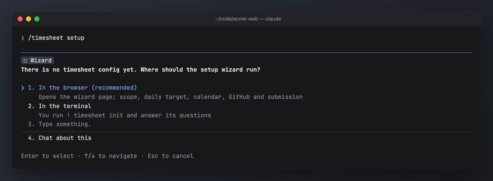

Once a week, about half a minute into a session, a toast says when last week still needs something: days not computed, days flagged for a look, or (with submission set up) workdays not entered yet. It reads only days already computed and never starts the classifier.

## The web app

`/timesheet open` (or `timesheet serve --open`) starts it on http://127.0.0.1:4280. The screenshots use generated demo data; [scripts/demo](../scripts/demo/README.md) rebuilds it.

**Timesheet** has Day, Week and Month ranges. Each day card shows real against booked hours, and the booked hours can be edited in place; *Reset* drops an override. *Lock* freezes a day. *Show other activity* adds personal and unassigned time, and *Recorded minutes* shows the exact timestamp-backed minutes. The app follows the system's light or dark theme.

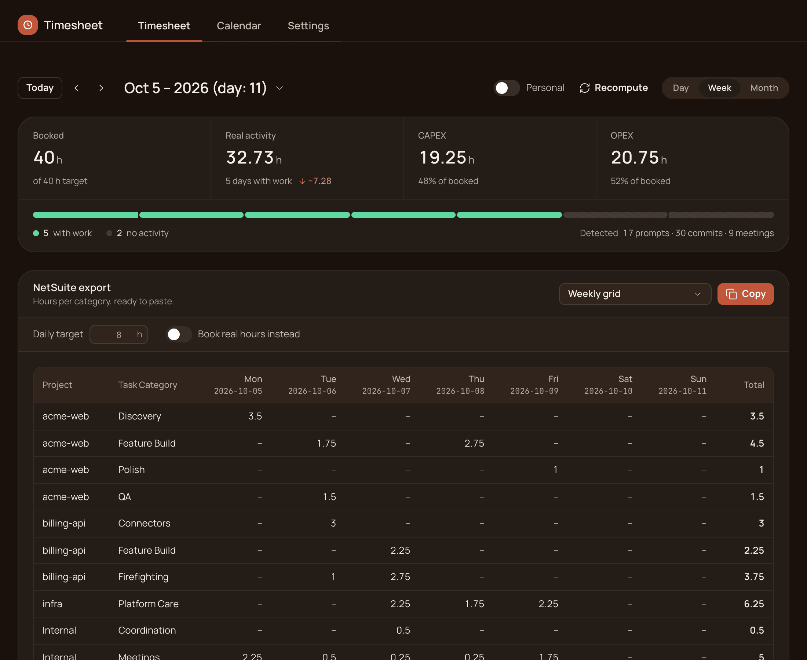

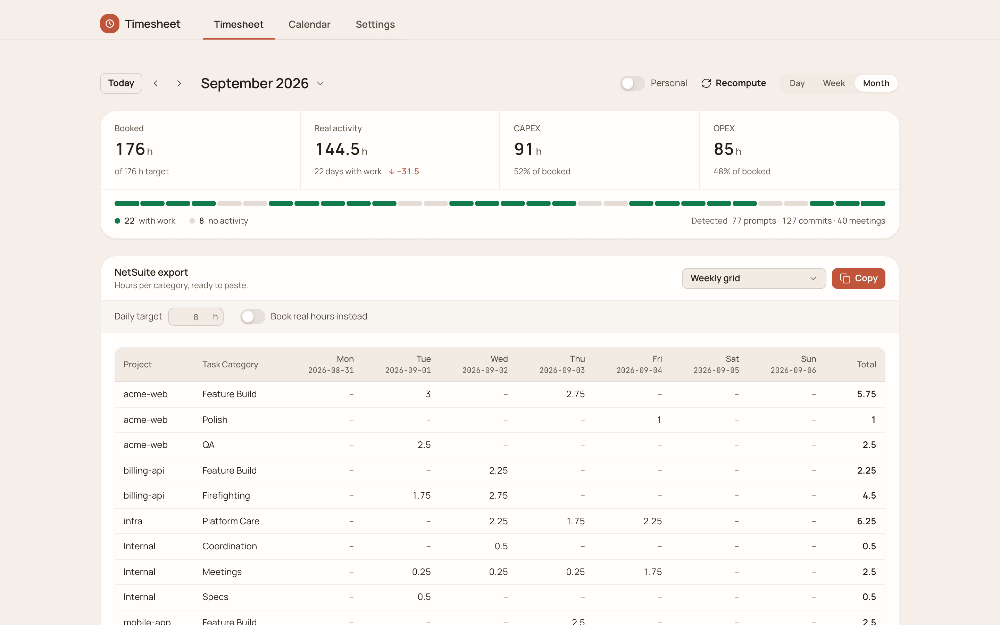

Click a time block to see what it was built from: the commits, branches, sessions and prompts behind it.

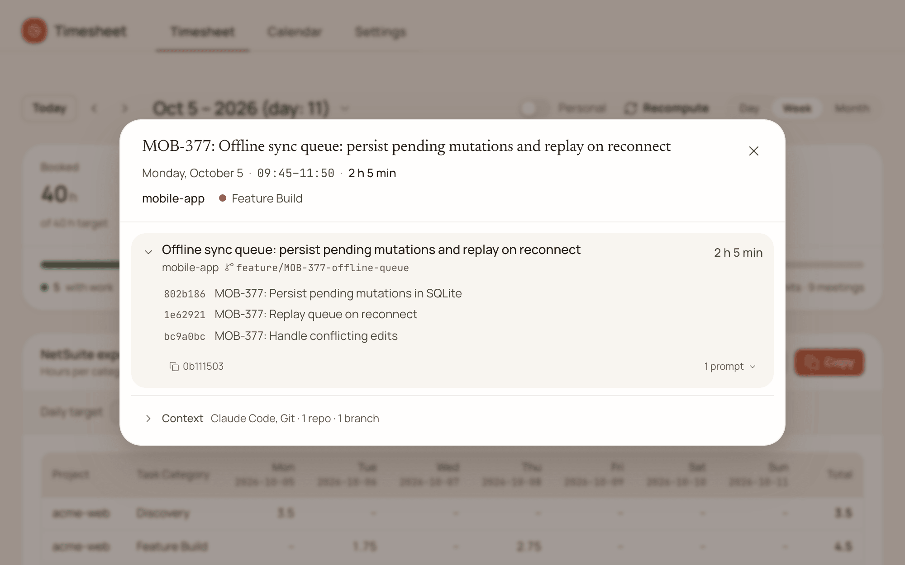

The **Submission** panel shows per system whether the week is ready and the entries it would make. Nothing is written until you confirm in the terminal (`timesheet submit week`).

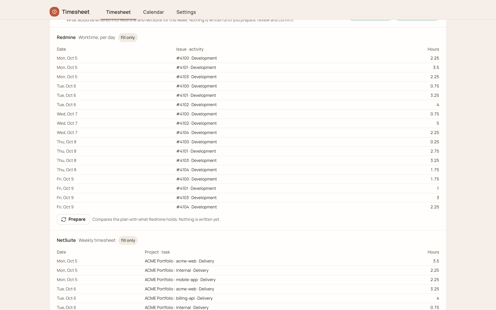

**Calendar** shows the same blocks in Day, Week, Month, Agenda and Resources views, coloured by category or project. Drag a block to move or resize it. In Resources, drag it to another category to recategorize it.

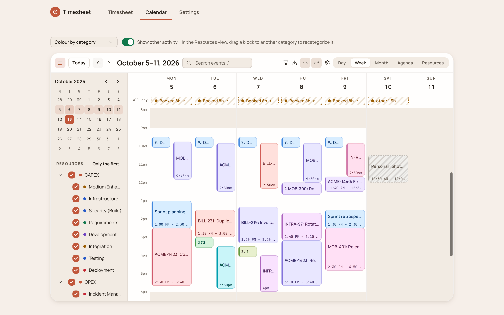

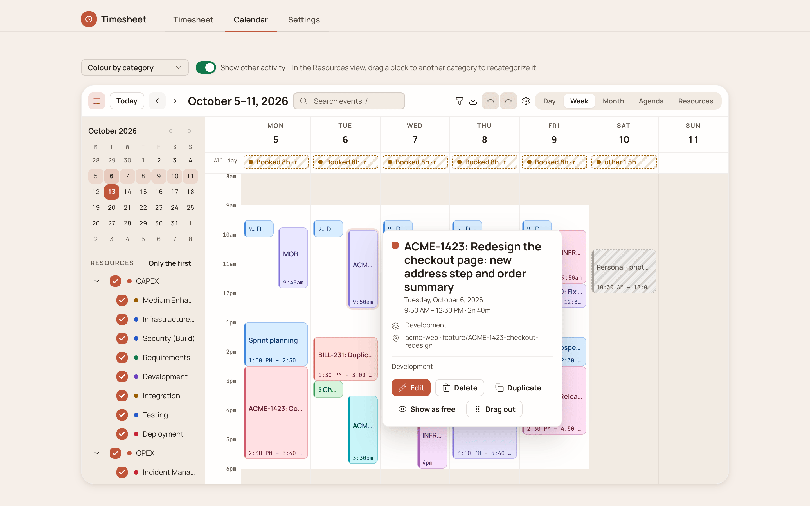

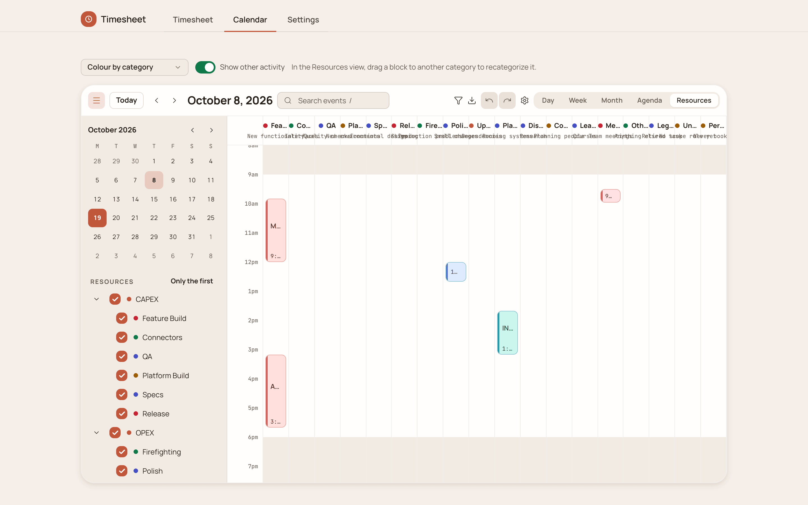

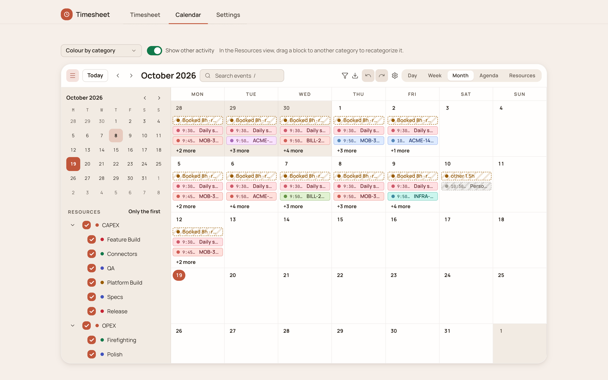

**Settings** covers projects and daily hours, activity sources, work scope (which repos and folders count as which project), GitHub, Google Calendar, task categories, classification, submission, and an Advanced section with the setup wizard and a raw JSON editor.

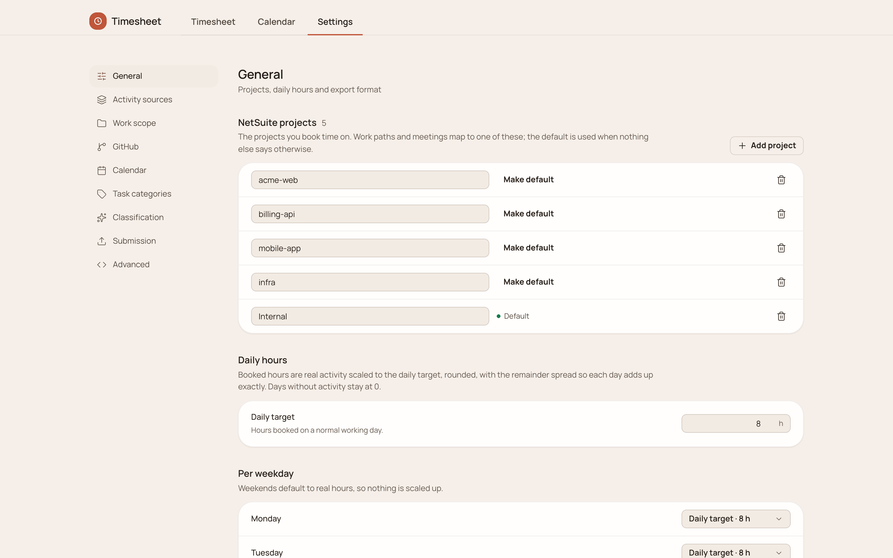

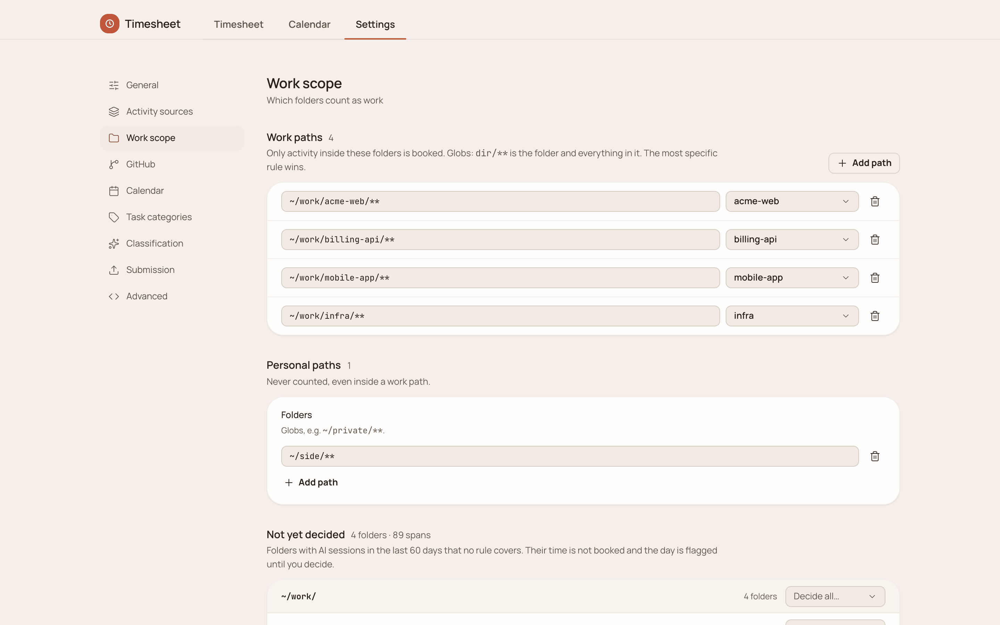

Task categories are company specific, so the list starts empty. **Paste a list** takes one name per line or rows copied from a spreadsheet (name, subtask, description, CAPEX/OPEX). A rule on a category ties it to the built-in checks: the default for work and for meetings, a fallback, no code (never claims time in which code was written), release (capped at the minutes releases take) and incident (needs a sign of a production problem). The categories in these screenshots are made up.

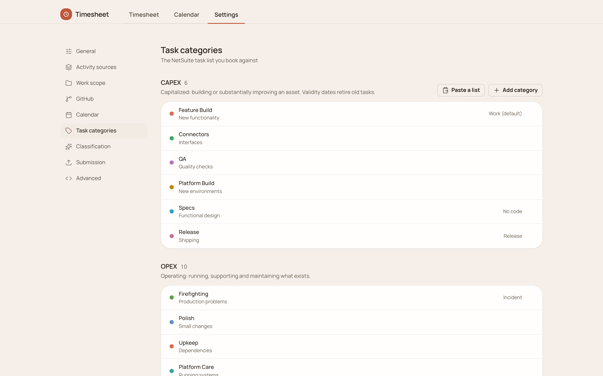

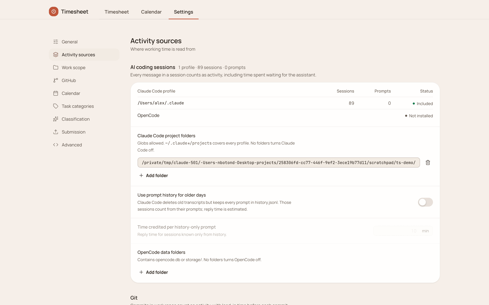

## From the terminal

The same demo data, from the CLI:

```
$ timesheet day 2026-10-08
Thu 2026-10-08  recorded 396.3 min · real 6.61h → booked 8h (target 8)
  09:30–09:45       15 min  meeting  Internal · Meetings  — Daily standup
  09:50–12:00    120.9 min  claude+git  mobile-app · Feature Build  — Design a queue for offline edits that survives app restarts | MOB-377: Persist pending mutations in SQLite
  12:00–12:40     37.2 min  claude+git  mobile-app · Polish  — Open the order screen when the push notification is tapped | MOB-390: Route push payloads to order screen
  13:40–15:10     83.7 min  claude+git  infra · Platform Care  — List certificates that expire within 30 days | INFRA-97: Rotate edge certificates
  15:10–17:40    139.5 min  claude+git  acme-web · Feature Build  — Split the checkout form into steps and keep the cart state in the URL | Why does the summary flash on step change?
    Feature Build            CAPEX  recorded   139.5 min  real  2.33  book  2.75  [acme-web]
    Feature Build            CAPEX  recorded   120.9 min  real  2.02  book   2.5  [mobile-app]
    Platform Care            OPEX   recorded    83.7 min  real   1.4  book  1.75  [infra]
    Polish                   OPEX   recorded    37.2 min  real  0.62  book  0.75  [mobile-app]
    Meetings                 OPEX   recorded      15 min  real  0.25  book  0.25  [Internal]

Total booked 8h (real 6.61h, recorded 396.3 min) · CAPEX 5.25h · OPEX 2.75h
```

```
$ timesheet review 2026-09-28
Week of 2026-09-28:
  2026-09-28      8h booked /    8h target · 6.6h recorded  [locked]
  2026-09-29      8h booked /    8h target · 6.8h recorded  [locked]
  2026-09-30      8h booked /    8h target · 6.8h recorded  [locked]
  2026-10-01      8h booked /    8h target · 6.6h recorded  [locked]
  2026-10-02      8h booked /    8h target · 2.4h recorded
      ✗ Only 2.4h of recorded work, booked as 8h: confirm it (`timesheet confirm 2026-10-02`) or set the hours (`timesheet edit`)
```

`timesheet week` prints the NetSuite grid (one row per project and category, one column per day). `--copy` puts it on the clipboard, and `--no-header` leaves only the rows for pasting into cells. The full command list is in [the manual](../timesheet/README.md#use).

## The launcher

Plugins live in a per-version cache, so their folder changes on every update. At session start the mod writes the current plugin folder to `<mods home>/timesheet/entry` and installs `~/.local/bin/timesheet`, a small script that reads that file (or `$TIMESHEET_ENTRY`). The entry never goes back to an older version: when profiles run different versions, it keeps pointing at the newest install that still exists, and an entry whose folder was removed by an update is rewritten. An existing `~/.local/bin/timesheet` that is not ours is left alone; `/timesheet install --force` replaces it. If `~/.local/bin` is not on `PATH`, the status says so.

`playwright-core` (only for NetSuite submission) is installed into the plugin folder the first time a submit URL is configured, once per version.

## Older installs

A copy of the skill at `<profile>/skills/timesheet/` (from the standalone install) shadows the plugin's newer skill. `/mods doctor` and `bin/mods install` point it out; remove it with `rm -r <profile>/skills/timesheet`. Data in `~/.timesheet` is used as is.

## Security

Google client secrets and tokens live in the OS keychain. The skill and the setup never ask for, print or store them; `timesheet init` is run by you (`! timesheet init`). The skill never runs `timesheet submit week`, `submit login` or `submit inspect`: it gives you the command. `timesheet submit plan` is read-only and allowed.
