# usage-analytics

One central store for everything about how every profile spends tokens, with a terminal report and a web dashboard.

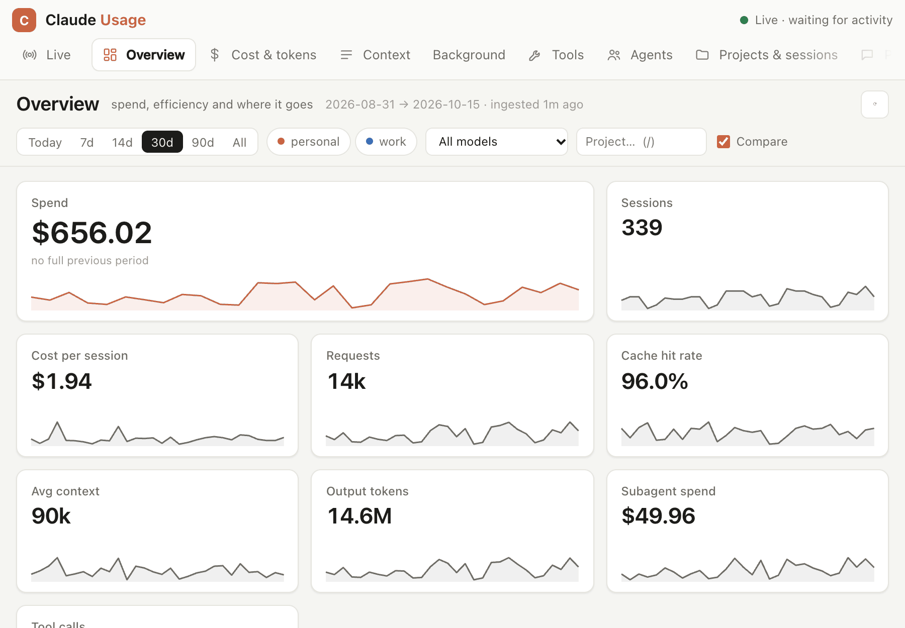

## Two data sources, one database

1. **Transcripts** (all history, every profile): `<config dir>/projects/**/*.jsonl` for `~/.claude*` and every registered or configured profile dir, subagent transcripts included (`<session>/subagents/agent-*.jsonl` + `.meta.json`). These carry exact per-request usage: input, output, cache read, 5m/1h cache writes, thinking, server tools, model, effort, speed, plus every tool call and result, prompts, attachments, system events (turn durations, compactions, API errors) and titles.
2. **The mod's live event log** (sessions run with the mod installed): `<mods home>/usage-analytics/events/<profile>/<day>/<session>.<ts>.<n>.jsonl`. It records what transcripts cannot:
   - time to first token and step latency;
   - tool latency and denials;
   - the `/context` category breakdown;
   - tool schema sizes and whether each is deferred;
   - system prompt section sizes;
   - rate-limit percentages;
   - compaction before and after;
   - environment: git, gateway host, a settings subset and enabled plugins.

`bin/claude-usage ingest` folds both into **`<mods home>/usage-analytics/usage.db`** (SQLite, WAL). Ingest is incremental by byte offset and lock-protected; `--full` rebuilds. The dashboard server ingests within about a second of any activity (see *Live updates*). The mod also runs an ingest 45s after a session starts and then every 30 minutes, as a fallback when the server is not running.

## On by default

Active right after install, with no setup:

| Feature | Default | How to change |
| --- | --- | --- |
| Event log (requests, tools, latency, `/context` breakdown, environment) | on, always | not switchable; sizes: `maxInputChars`, `maxResultChars`, `maxAnswerChars` |
| Prompt text kept | **on** (`storePrompts` true) | `storePrompts: false` keeps length only |
| Tool results kept | off (`maxResultChars` 0: size only) | `maxResultChars` |
| Claude Code's own telemetry events logged | on (`captureOtel`) | `captureOtel: false` |
| All profiles' transcripts imported | on: `~/.claude*` plus every config dir a session ran from | `profileDirs` |
| Background ingest | on: 45s after session start, then every 30 min (`autoIngest`, `ingestEveryMin`) | config |
| Dashboard server | **on**: started at session start and by every `/analytics` command, one per machine, `127.0.0.1:8787` | `dashboard: false`, `port` |
| Dashboard at login | **off** | `claude-usage autostart on` (or `/analytics setup`) |
| History backfill | on: runs when the server first starts | none |
| Secret redaction | on, always | not switchable |
| Weekly digest toast | on (`weeklyDigest`) | `weeklyDigest: false` |
| Advisor verdict toast | on (`advisorNotify`) | `advisorNotify: false` |
| Advisor research | **off**: runs only on `/analytics advise` or `advise bg` | n/a |
| Gateway spend sync | on, but only when `ANTHROPIC_BASE_URL` is not anthropic.com and an auth token is set; 12 months back | `gatewayMonths: 0` |
| Python 3 | required for the database and dashboard; without it events are still recorded | install it |

`/mods pause` does not stop this mod (it only observes).

## Setup, backfill and the server

Nothing is required: on first start the mod writes its config with defaults, registers the profile's config dir, starts the dashboard server and joins the one `/mods` toast of the session. **`/analytics setup`** first checks for python3 (and says how to install it when it is missing), then runs `claude-usage setup --json` (detected profiles with history, what is already imported, the port) and asks which profiles to track, whether to keep prompt text, and when the dashboard runs.

**Backfill.** When the server starts it imports every transcript already on disk in the background, so the dashboard has your full history from day one. The page shows a progress bar (the stage — sessions, subagents, mod events — with the profile being read, files, requests, %, and a note that the numbers are partial until it finishes) and redraws as data arrives; an empty database shows a first-run screen instead of empty charts. `/api/meta` carries the same `progress`.

**One server per machine, started when needed.** Every session start, every `/analytics` command and `/dashboard` start it if it is not running (a lock file keeps it to one), and replace one older than the installed mod. `claude-usage autostart on` also starts it at login and re-checks every 10 minutes (a launchd agent `dev.claude-mods.usage-dashboard` on macOS, a systemd user timer on Linux); `off` removes it. It is off until you turn it on. `"dashboard": false` keeps it off until you run `/dashboard`.

## Use it

| | |
| --- | --- |
| `/analytics setup` | the setup wizard |
| `/dashboard [tab]` or `/analytics dashboard [tab]` | starts the dashboard in the background and opens **http://127.0.0.1:8787/** (on a tab: live, overview, cost, context, background, tools, agents, projects, prompts, mood, health, engine, advisor, recurring, impact, savings, sql) |
| `/analytics advise` (or `advise now`) | research how to use Claude cheaper, with fewer tokens, faster and more reliably, here in the conversation ([below](#the-advisor)) |
| `/analytics advise bg` · `show` | the same research in the background · the trends, findings and recommendations in the terminal |
| `/analytics advise apply <id>` | shows the exact change, asks before making it, and starts measuring it |
| `/analytics advise trial <id>` | runs a recommendation that is a model instruction as an A/B trial: a random half of new sessions get it |
| `/analytics advise applied\|accept\|dismiss\|revert <id> [note]` | record what you did with a recommendation (a dismissal's note teaches the next run) |
| `/analytics advise reproduce <id>` | re-runs a recommendation's evidence queries and its verification, and says whether they give the same numbers |
| `/analytics recurring [--days N] [--profile P] [--project X] [--min N]` | the prompts you keep typing, found without a model ([below](#recurring-asks)) |
| `/analytics recurring classify` · `classify bg` | a model names each ask and drafts an automation, here in the conversation or on a background agent |
| `/analytics recurring show <id>` · `automated\|dismiss\|reopen <id> [note]` | one ask with its samples and draft · set its status |
| `/analytics impact [--days N] [--profile P]` | are the mods saving money or costing more ([mod-impact.md](mod-impact.md)) |
| `/analytics digest` | last week against the week before: spend, sessions, cache hit, top project and model, new advisor suggestions. The same comes as a toast once a week (`weeklyDigest`) |
| `/analytics summary [--days N] [--format md\|html] [--no-projects] [--out F]` | a shareable summary (totals, by day, models, project names without paths, mod verdicts; no prompts or code), saved under `<mods home>/usage-analytics/summaries/`. The dashboard's **Share summary** button opens the same page for the period on screen (shift-click: Markdown) |
| `/analytics status` · `/analytics ingest` · `/analytics stop` | data and dashboard status · ingest now · stop the dashboard |
| `/analytics [overview\|profiles\|daily\|models\|projects\|tools\|bash\|files\|agents\|sessions\|context\|hours\|cache\|prompts\|gateway\|all] [--days N] [--profile P] [--project x] [--limit N]` | terminal report (ingests first; `--days` defaults to 30, 0 is all time) |
| `claude-usage ingest [--full] [--quiet]` · `report [what]` | fold new data in (`--full` rebuilds) · the terminal report from a shell |
| `claude-usage serve [--port N] [--daemon] [--open] [--tab T] [--quiet]` · `stop [--port N]` · `status` · `impact [--days N] [--profile P] [--json]` | the same from a shell |
| `claude-usage setup [--json]` · `autostart on\|off\|status` | what was detected · start the server at login |
| `claude-usage digest [--line\|--json]` · `summary [--days N] [--format md\|html] [--out F\|-]` | the weekly digest · a shareable summary (`GET /api/summary?days=&format=` on the dashboard) |
| `claude-usage recurring [show\|brief\|record FILE\|set ID STATUS] [--days N] [--min N] [--json]` | the recurring asks and their labels from a shell |
| `claude-usage advise [show\|brief\|record\|set\|get\|reproduce\|sql\|due\|notify\|fail]` | the advisor's store from a shell |
| `claude-usage sql "SELECT …"` · `schema` · `export TABLE --format csv\|jsonl [--out F]` · `reprice` · `scrub` · `path` | query, tables, export, recompute cost after editing `pricing.json`, redact secrets in stored data, print the data dir |

`claude-usage` lives at `usage-analytics/bin/claude-usage` (Python 3, stdlib only). An alias is handy:
`alias claude-usage='python3 ~/Desktop/projects/claude-mods/usage-analytics/bin/claude-usage'`.

## The advisor

A loop that keeps looking for ways to spend less on Claude Code, and checks whether its advice worked:

1. **Measure.** Twenty-five metrics per session, grouped by goal. *Cost*: cost per prompt, premium-model share, spend inside subagents, cache writes after an idle gap (the cache had expired). *Tokens*: tokens per prompt, main-loop context, cache hit rate, tool output per prompt, whole-file reads, output per request, share of prompts not in English, prompt length (eight). *Speed*: requests per prompt, turn time. *Reliability*: tool error rate, API errors, compactions. *Quality*: corrections per 100 follow-ups, interrupts and rejected tool calls per 100 prompts, edits that redo Claude's own new lines, turns whose last check passed, editing turns with a check, lines kept at the next commit, edited files committed (see *Output quality*). For each one you get eight weekly values and the last 7 days against the 28 before, with a bootstrap 95% interval.
2. **Detect.** Deterministic findings, no model involved, each tied to the metric it moves: large contexts, a low cache hit rate, whole-file reads, heavy tool output, a failing tool, serial tool calls, premium models in subagents, non-English prompts, frequent compaction, API errors, and big always-loaded MCP schemas. It also diffs consecutive session starts to show your own setting changes (model, effort, plugins, version).
3. **Research.** An agent (`usage-analytics:advisor`) reads all of the above. That includes every earlier recommendation with its measured verdict and evidence grade, a track record per goal and per kind of change, its earlier notes, each metric per project, profile and entrypoint, and a sample of prompts. It looks up current guidance on the web and records 3–6 recommendations, held to the rules below.
4. **Apply or trial.** `/analytics advise apply <id>` shows the change and asks before making it. You can also make the change yourself and run `/analytics advise applied <id>`, or use the dashboard's buttons. A recommendation that is a model instruction (read ranges, batch calls, …) can instead run as an **A/B trial** (`/analytics advise trial <id>`, or *Start A/B trial*).
5. **Verify.** Each applied or trialled recommendation is measured on its own metric and on the guard metrics (cost per prompt, round trips, tool errors, API errors, turn time, and the quality guards: corrections, checks passing, interrupts) for side effects. A saving that makes the output worse is not graded as *helped*. Verdicts:
   - **helped**
   - **helped, with a cost**: a guard metric got worse by at least 10% and past a small absolute floor
   - **made it worse**
   - **no measurable effect**: the interval rules out half the expected effect, or there are already as many sessions as the power calculation asked for
   - **measuring…**: until there are 8 sessions on each side

   You get a toast when a verdict changes. The next research run reads the verdict: it builds on what helped, proposes reverting what backfired or did nothing, and does not repeat what you dismissed.

### How it keeps the advice honest

**Claims come from your data and can be re-run.** Every number in a recommendation is an `{claim, sql}` pair. The query is re-run when the recommendation is recorded, and the result is stored next to it. A failed query, a recommendation with no query, a recommendation without a primary source (Anthropic's docs, pricing, changelog, or the anthropics GitHub repos), or an expected effect too small to detect becomes a warning on the card. Research notes keep their source, published date and the day they were checked. Notes older than 90 days are flagged stale, and the next run re-checks them against the changelog.

**Fitted to you.** Your data beats web advice. The brief shows each metric by project, profile and entrypoint (interactive vs automated). A recommendation can be scoped to the projects or profiles where its lever lives. Every scoped recommendation is measured only there, and its verdict is broken down per project, because what helps one project can hurt another. The track record (success rate per goal and kind of change, Laplace-smoothed) steers the next run away from advice that keeps failing for you.

**Measured with the strongest design the data allows.** Each recommendation gets an evidence grade:

| Design | When | Grade |
| --- | --- | --- |
| **randomized** | an instruction on trial: a random 50% of new sessions get it (FNV hash of rec and session id, logged as `advisor_arm` events); after adopting it, 10% stay a holdout so the effect stays measured | **A** |
| **control group** | a scoped change with enough untouched sessions: the change in scope net of the change outside it (difference in differences) | **B** |
| **before/after + placebo** | the 28 days before vs after, plus the same comparison one window earlier, which should show nothing. If that placebo finds a drift, the estimate is trend-adjusted. | **B** without confounders, else **C/D** |
| evidence only | re-run queries plus a primary source, not yet measured | **C** |
| anything weaker | | **D** |

Confounders, meaning setting changes and other recommendations started within 7 days, are listed on the verdict and keep it out of grade B.

**The statistics.** Metrics are ratios of per-session sums. Comparisons are directly standardized by project, so a change in which projects you worked on does not read as an effect. Intervals come from a stratified percentile bootstrap: 1000 resamples for a verdict, 400 for side effects. Before recording, a delta-method power calculation (80% power, 5% level) estimates how many sessions a verdict will need at your pace, and the advisor prefers metrics that can detect the effect. For example, a 20% drop in whole-file reads shows within days, while a 20% drop in cost per prompt can take months. Trends are a Theil–Sen slope with a Mann–Kendall p-value, and count only when they move at least 5% over the eight weeks.

**Reproducible.** Seeds come from the recommendation id and the metric, and every verdict stores its method version, seed, resamples, windows, data version and a hash of the session ids. `/analytics advise reproduce <id>` re-runs everything and reports `identical` when nothing changed. `tests/test_advisor_stats.py` checks the statistics on synthetic sessions with a known truth: a real effect is found and covered by the interval, a null is rarely flagged, a change in the mix of work is ignored, the same input gives the same numbers, and power() matches simulation.

**When it runs.** Only when you ask. `/analytics advise` runs the research in the conversation, where you can watch and steer it. `/analytics advise bg` runs it on a background agent on `advisorModel` (default Sonnet), which reports back into that session when it is done. The mod never starts it on its own, because a background agent's report always lands in the session that started it. A lock keeps it to one run per machine.

The background agent can use only WebSearch, WebFetch and the mod's own four tools. The mod answers those four tools itself and never runs a shell for the agent. The agent runs with `dontAsk`, so anything else is refused instead of prompting, and it never edits files.

**Where it lives.** Everything is stored in `<mods home>/usage-analytics/advisor.db`: runs, recommendations, verdict checks and research notes. Instructions on trial or adopted are in `advisor-trials.json`, which the mod reads at each new session. While one is active, it adds a short `usage-analytics:advisor` system-prompt section in that trial's 'on' sessions, and only there. `claude-usage advise show|brief|sql|set|…` reads and writes the same data from a shell.

## Output quality

Cost and token numbers alone can't tell a cheaper setup from a worse one. These signals, read from the transcripts and git, show whether the output held up. All of them are heuristics, and every rule is in `bin/quality.py`:

| Signal | Rule |
| --- | --- |
| Correction | a follow-up prompt (not the session's first) that pushes back or asks for a redo: "no…", "still broken", "revert that", "are you sure", a bare "fix", a pasted error. Leading screenshots and pasted blocks are skipped. |
| Interrupt | the turn was stopped (`[Request interrupted by user]`, prompt kind `interrupt`) |
| Rejected call | you said no to a tool call (`tool_uses.flag = 'rejected'`; a rule or hook saying no is `denied` and is not counted) |
| Redone edit | an edit that replaces lines Claude wrote earlier in the same turn, or a second Write of the same file |
| Check | a test, typecheck, lint or build command (`tool_uses.verify`), found behind `cd`, env vars, `npx`, `uv run`, `python -m` and pipes. It fails when it errors **or** its output shows failure marks (`1 failed`, `FAIL`, `error TS…`, a traceback…), since `npm test \| tail` exits 0. A turn counts as passed when its last check passed. |
| Lines kept | for each edited file in a git repo, the first commit (any branch) within 3 days after Claude's last edit, and the share of Claude's written lines found in it. Only line hashes are stored. A file without such a commit counts as not committed, once the 3 days are over. |

`claude-usage report quality [--days N] [--project X]` prints the numbers, then cost and quality side by side per model, per model and effort, and per project. Use it to see whether a cheaper model, a lower effort or a smaller context did the same work. The advisor's A/B trials and before/after verdicts check the quality guards automatically.

## Frustration meter

Every main-loop prompt gets a score from 0 (calm) to 100 (rage): the sum of the weights of the signals it shows, capped at 100. Code blocks, pasted blocks, inline code, links and paths are left out first, so a pasted SQL query or log is not "shouting". All rules and weights are in `bin/frustration.py`:

| Signal | Weight | Rule |
|---|---|---|
| swearing | 35 | fuck, shit, wtf, ffs, damn, kurva, bazdmeg, … |
| insult | 30 | stupid, idiot, useless, incompetent, … |
| giving up | 20 | "forget it", "never mind", "I'll do it myself", "this is ridiculous" |
| repeating self | 15 | "how many times", "I already said", "for the third time", "you keep" |
| correction | 15 | a push-back or redo (the *Output quality* rule) |
| shouting | 15 | in prose lines: two or more ALL-CAPS words (acronyms left out) making up a quarter of the words, or mostly upper case |
| repeated ask | 15 | nearly the same words as one of the 3 prompts before it |
| blame | 10 | "you broke", "why did you", "did you even" |
| punctuation | 10 | `!!`, `???`, `?!` |
| after interrupt | 10 | the previous turn was stopped |
| rejected calls | 10 | a tool call was refused in the previous turn (not on top of an interrupt) |
| elongation, terse | 5 | "nooooo"; a correction under 20 characters |

Levels: calm 0, mild 1–24, annoyed 25–49, frustrated 50–74, rage 75+. Each prompt is tied to the model and effort that answered the turn before it, the one being reacted to. Scores live in the `mood` table; changing a rule bumps `VERSION` and every prompt is scored again at the next import.

The **Frustration** tab (under Quality) shows KPI tiles, the score per day and per week, levels per day, a weekday×hour heatmap, signals over time, the score by model and effort and by project, the most heated prompts and sessions. `claude-usage report frustration [--days N] [--project X]` prints the same in a terminal. The advisor tracks the average score and the frustrated share, and the frustrated share is a guard: a recommendation that makes you angrier is not graded as *helped*.

## Mod spend

The mods call models on their own: the timesheet classifier, the advisor and recurring agents here, budget-guard's Haiku classifier (routing and the new-task check) and its keep-alive pings. The **Mod spend** tab (under Spend, `/dashboard background`) shows only that, nothing you or your own scripts ran: its total and share of all spend, in-session calls, cost per run, context sent per request, spend per day by caller, a table by caller with the models it uses, and the most expensive runs. It reads the `v_background` view: requests from the timesheet classifier's folder or from a mod's agent (`usage-analytics:advisor`, `usage-analytics:recurring`, …), plus budget-guard's `classify` and `keepalive` events. Those calls have no transcript of their own. A keep-alive ping logs its own cost. The Haiku classifier logs only its input size, so it is priced at Haiku 5.5 list price, with about 60 tokens of instructions and a 5-token answer added. Your own `claude -p` and Agent SDK runs are under Cost, by entrypoint.

A caller is flagged when a mod's call sends more than 15k tokens of context for one or two requests. That is Claude Code's own system prompt and tool list riding along with a short classification. Timesheet 0.3.7 runs its classifier with no tools, MCP servers or skills and a one-line system prompt: about 3.5k tokens of context per day instead of 25–36k, around 7× cheaper on the same model. The classifiers in this mod (frustration, quality, recurring detection) are rules and cost nothing. Only the recurring labels and the advisor use a model, and only when you start them.

## Recurring asks

Some prompts you type again and again: "bump the version and tag it", "why did CI fail on this branch", "write the PR description". Each one could be a skill, a slash command, a hook or a line in CLAUDE.md. The Recurring tab finds them.

**What it finds.** Only prompts you typed in the main conversation: not subagent prompts, not slash commands, and not headless runs (`claude -p` and the SDK, such as the timesheet classifier or the advisor), which are automated already. `--headless` counts those too. No model is involved. Each prompt is cut to the part you wrote (code blocks and pasted logs dropped), then paths, URLs, numbers, ids, branch names and quoted text are removed, and the rest is lower-cased and reduced to word stems. Prompts that share at least 55% of their words are one ask, so "check why CI failed on feat/a" and "why did the CI run fail on fix/b" land together. An ask is recurring when it has at least 3 prompts on at least 2 different days (`--min`, `--min-days`). One-word replies like "continue" are left out. 50,000 prompts take a few seconds.

**What you see.** Per ask: how often (times, days, per month), what it cost (every request until your next prompt), a weekly trend, a few different samples and a score from 0 to 100 for how automatable it looks, with the reason. The score rises with frequency and steadiness, and with stable wording and a low price of the prompt; long, context-heavy prompts score lower. The cards show the recurring share of all prompts and what the recurring ones cost per month. A chart splits each week into recurring and one-off prompts.

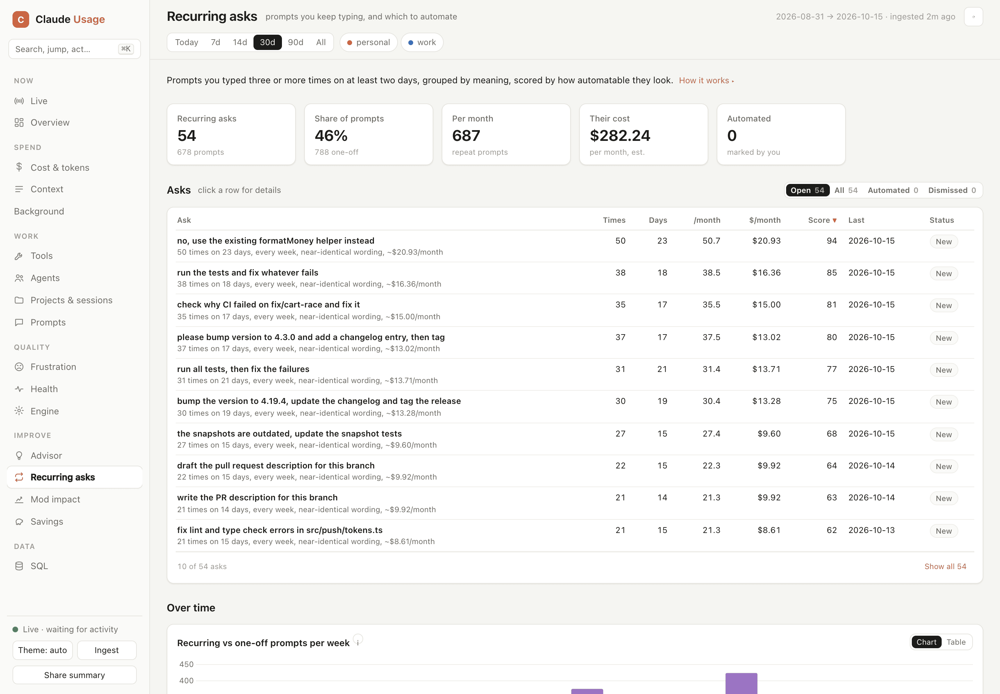

**Classify.** `/analytics recurring classify` has the model read the redacted samples and, for each ask, record a title, a category, an automation (`slash_command`, `skill`, `hook`, `script`, `claude_md_rule`, `mod_setting`, `scheduled_task`, or `none` when it needs judgment each time), a ready-to-save draft, a rationale and the prompts and dollars per month it would save (never more than the ask costs now). `classify bg` does the same on a hidden background agent on `advisorModel`; it starts only when you ask, and you get a toast when the labels are in. Labels are stored in `<mods home>/usage-analytics/recurring.db` and stay attached when the wording drifts.

**Act on it.** Copy the draft from the dashboard row (or `/analytics recurring show <id>`), save it as a skill, command, hook or CLAUDE.md line, then mark the ask `automated` (a button in the row, or `/analytics recurring automated <id>`). From that date the tab shows prompts per week before and after, with a verdict: stopped, dropped, unchanged, or too early. An automated ask that no longer turns up is listed as gone. `dismiss` hides an ask you do not want to automate; `reopen` brings it back.

| Command | What it does |
| --- | --- |
| `claude-usage recurring brief [--limit N] [--relabel]` | the unlabelled asks as JSON for a model |
| `claude-usage recurring record FILE\|-` | store labels: `{summary, clusters: [{id, title, category, automation: {kind, draft}, rationale, est_prompts_month, est_usd_month}]}` |
| `claude-usage recurring set <id> automated\|dismissed\|new [--note T] [--at ISO]` | change a status |

**Privacy.** Prompt text is redacted for secrets when it is stored. The samples a model sees are clipped to 240 characters and redacted again, and a draft is redacted before it is saved. Nothing leaves the machine except what the classify run sends to the model you are already using. The ask data never goes in a request on its own.

## One server per machine, started for you

The dashboard server starts by itself. Each session start runs `claude-usage serve --daemon --quiet` in the background, and so does every `/analytics` command. Each run takes a machine-wide lock (`dashboard.lock`) and checks `127.0.0.1:8787/api/ping`:
- **Nothing is answering:** it starts the server.
- **The same or a newer version is answering:** it leaves it running.
- **An older version is answering:** it replaces it. After a plugin update, the next session therefore serves the new code with no manual restart.

When all three profiles start at once, only one server comes up. Set `"dashboard": false` in config.json to turn the auto-start off.

## Live updates

Every prompt, model request, tool call, turn end, compaction and session start or end touches `live/<profile>.json`. The touch is throttled to once per 750ms, except turn ends.

The server checks those files every second. On a change it does two things:
- It runs the incremental ingest: about 80ms when there is little new, and only the bytes added since last time.
- It runs it again 3s later, to catch transcript lines written after the touch.

Sessions without the mod are covered by a 20s fallback ingest.

Whenever an ingest reads something new, the server pushes an `update` event over server-sent events (`/api/stream`). The page then reloads the current view in place:
- charts animate to the new values;
- tables keep their sort, filter and scroll position;
- new feed rows flash.

The heavy views (Mod impact, Savings) show a "new data" banner instead of recomputing. The sidebar shows the connection state and when the last update came in. Hidden tabs catch up when they become visible again.

## The dashboard

It is served only on 127.0.0.1. It answers only requests addressed to `127.0.0.1`/`localhost`, which blocks DNS rebinding. `/api/sql` is read-only, and cross-origin POSTs are refused. The page is a single file, `usage-analytics/dashboard/index.html`. It uses Chart.js 4.4.1 from jsDelivr, pinned with SRI. The queries are in `bin/dashboard_api.py` (dict `Q`): add one there and reference it from a panel in `TABS`.

The filters (period, profiles, model, project) apply to every panel. Click any session id, or a dot in the session scatter, to open its drill-down.

**Layout**
- A sidebar groups the tabs: Now, Spend, Work, Quality, Improve, Data.
- The filter bar is sticky.
- The theme toggle switches between auto, light and dark.

**KPI cards**
- Each card shows its change against the previous period of the same length; *vs previous* turns this off. On *Today* the comparison is with yesterday up to the same time.
- No comparison is shown when the data does not cover the whole previous period.
- Each card has a daily sparkline.

**Every panel**
- expand to full screen;
- download as CSV;
- switch between chart and table;
- tables are sortable and filterable, with in-cell bars on cost and size columns.

**Keys**
- <kbd>⌘K</kbd> opens a command palette: go to a tab, set the period, pick profiles, ingest, toggle the theme.
- <kbd>[</kbd> / <kbd>]</kbd> previous or next tab.
- <kbd>r</kbd> refresh.
- <kbd>t</kbd> theme.
- <kbd>/</kbd> project filter.
- <kbd>esc</kbd> close.

| Tab | Shows |
| --- | --- |
| Live | Today against yesterday at the same time; the last 60 minutes ($/h); month to date with a projection and a progress bar; active sessions (last 30 min) with a context gauge, cost and cost in the last hour; spend and requests per minute for the last 3 hours by profile; today by hour; feeds of the latest model requests and tool calls. Uses the profile filter. |
| Overview | KPIs and automatic insights: the month's pace and projection, spend spikes (days above mean + 2σ), spend above 200k context, Bash share of output, whole-file reads, Write vs Edit, single-tool requests, cache hit rate, LSP use. Also daily spend by profile, spend by token kind, spend by context size, profiles, models, a weekday×hour heatmap, model family mix per day and the top sessions. |
| Cost & tokens | Daily spend by model; tokens per day; cost per 1k requests; cache hit and subagent share per day; requests per day by model family; spend by effort, entrypoint, stop reason, version and hour. |
| Context | Requests and spend by context bucket; main-loop context per day; tool calls per request (parallelism); the `/context` composition and its trend (from the mod); injected attachments. |
| Tools | Output by tool; per-day output; result-size distribution; Bash programs and commands (`capped` marks commands cut by lean-tools or budget-guard); whole vs ranged Reads; Edit vs Write; files by traffic; re-reads; extensions; LSP vs grep; MCP; skills; web; errors. |
| Agents | Spend by agent type; which model each type ran on; spawns by type and `model` parameter; the most expensive subagents. |
| Projects & sessions | Spend per day for the top 8 projects; a scatter of session cost against peak context (click a dot); spend by project and branch; the session cost distribution; the session list. |
| Prompts | Prompts and commands per day; message kinds; prompt length; slash commands; the most expensive prompts (all requests until the next prompt); recent prompts. |
| Frustration | Score per prompt, day and week; levels per day; weekday×hour heatmap; signals; by model, effort and project; most heated prompts and sessions ([above](#frustration-meter)). |
| Health | API errors, compactions and notices per day; turn durations; recent errors; compactions. |
| Engine | From the mod: TTFT and latency by model; tool latency; tool schema sizes; system prompt sections; rate limits; event counts. |
| Advisor | Metric trends, findings, recommendations with their evidence grade and verdict, A/B trial controls ([above](#the-advisor)). |
| Recurring | KPI cards, a sortable table of recurring asks (click a row for samples, weekly trend, the drafted automation with Copy, and status buttons), prompts per week before and after an ask was marked automated, and recurring vs one-off prompts per week ([above](#recurring-asks)). |
| Mod impact | Per mod: holdout verdict, active vs holdout metrics with 95% intervals, the cost/savings ledger, nudge compliance, action counts, warnings. See [mod-impact.md](mod-impact.md). |
| Savings | From budget-guard's ledgers: dollars saved by lever, per day against spend, and per profile. |
| SQL | A read-only console with examples. ⌘/Ctrl+Enter runs the query. |

**Session drill-down:**
- context per request alongside cumulative cost;
- cost by agent;
- tool output by tool;
- every prompt, tool call, subagent and request.

### A tour of the dashboard

The screenshots use generated demo data (two profiles, 45 days, about 260 sessions); [scripts/demo](../scripts/demo/README.md) rebuilds it.

**Live.** Today against yesterday at the same time, the last hour's burn rate, the month's projection and the sessions running now, each with its context gauge.

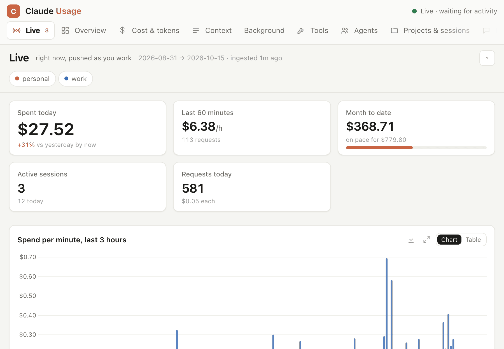

**Overview**, in the dark theme. The insights at the top are computed from the filtered data: here the month's pace and the cache hit rate.

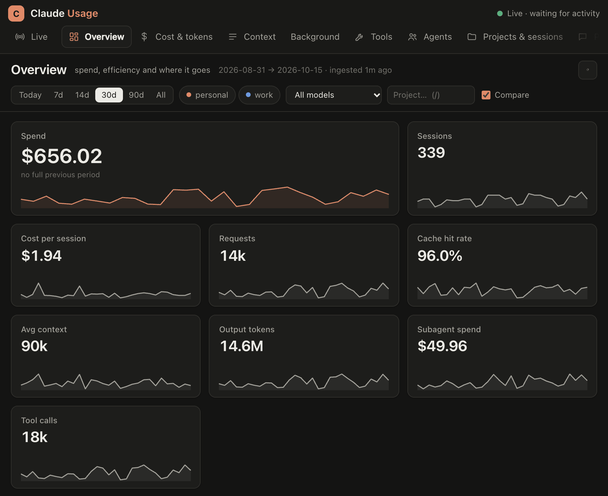

**Cost & tokens.** Spend per day by model, tokens per day by kind, cache hit rate and the subagent share.

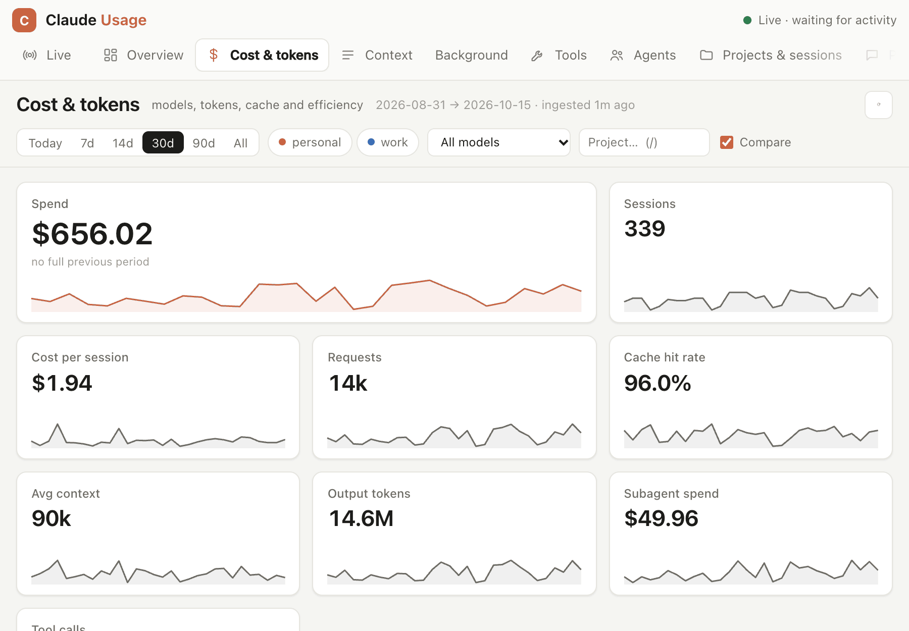

**Context.** How much each request carried. Requests above 200k cost the most per call, and the `/context` composition shows what fills the window.

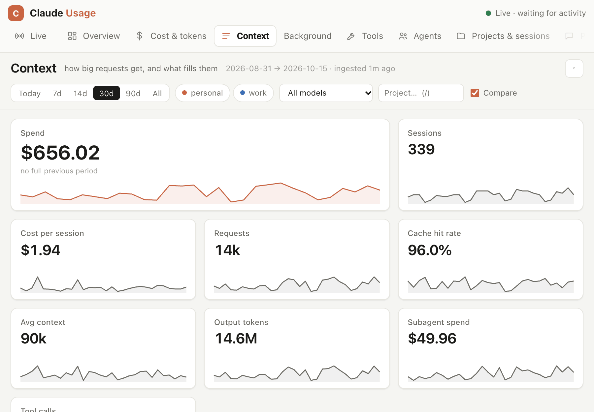

**Mod spend.** What the mods themselves spend on models: the timesheet classifier, mod agents, budget-guard's Haiku classifier and keep-alive pings, by caller. Here the classifier's context per request drops once it runs lean.

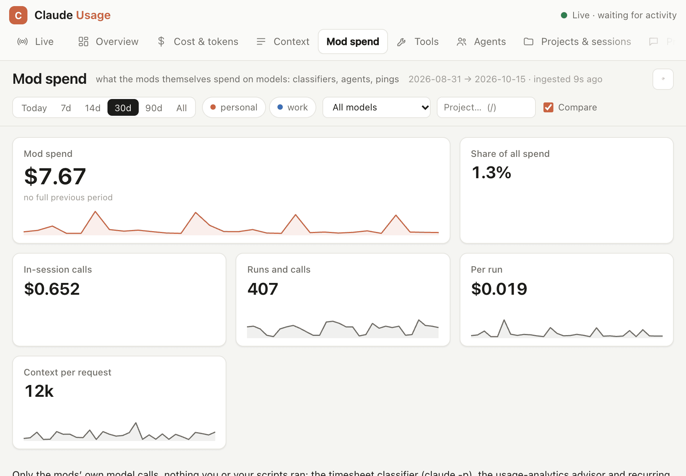

**Tools.** Where tool output comes from (Bash usually dominates), whole against ranged reads, Edit against Write, and LSP against grep.

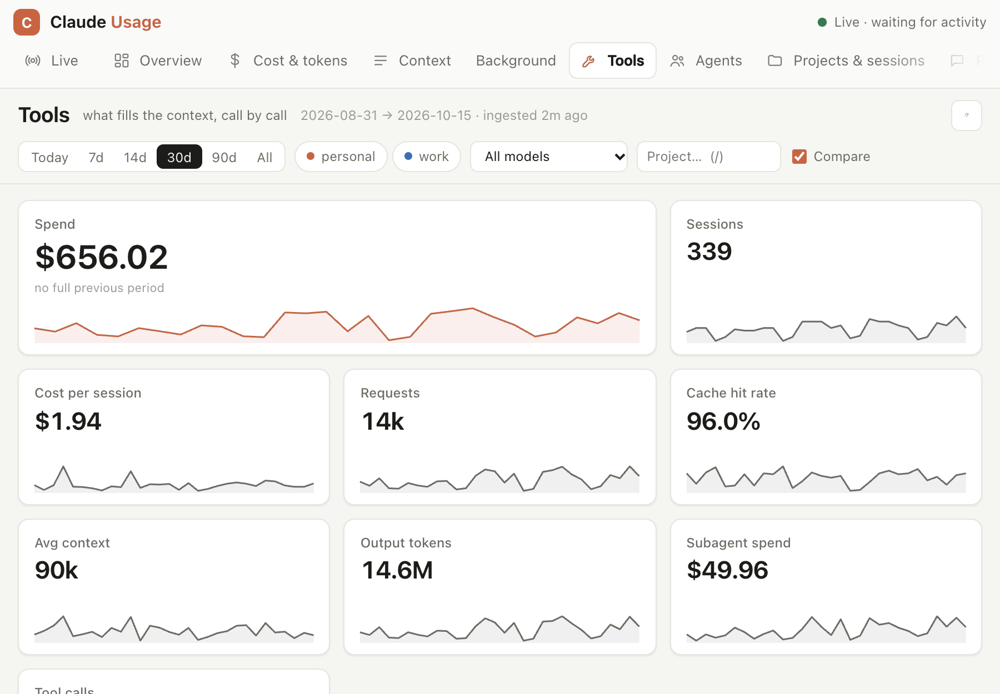

**Agents.** Spend by subagent type and the model each type actually ran on. With budget-guard's routing, Explore runs on Haiku and most others on Sonnet.

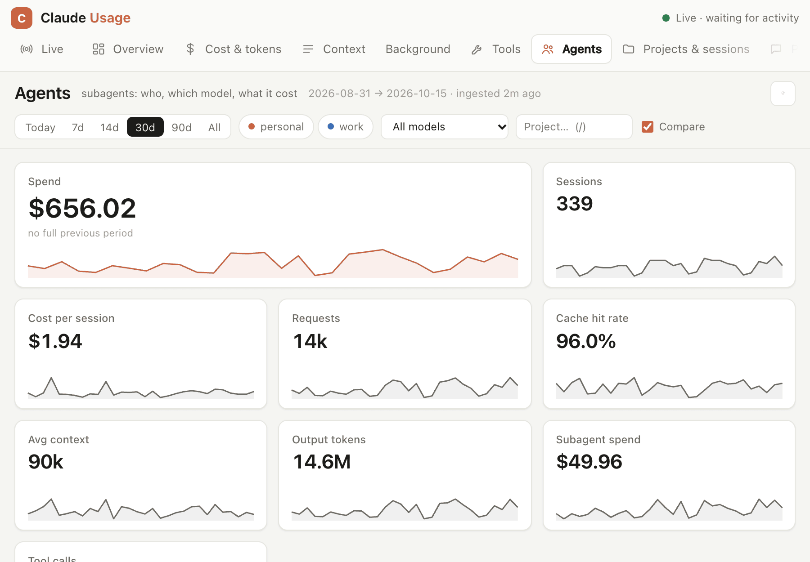

**Projects & sessions.** Spend per project per day, and a scatter of session cost against peak context. Click a dot to open that session.

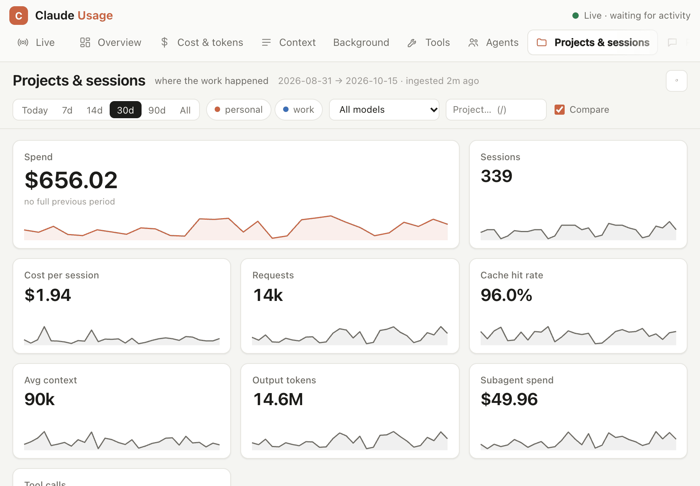

**Session drill-down.** Context per request next to cumulative cost, cost by agent, output by tool, and the full timeline.

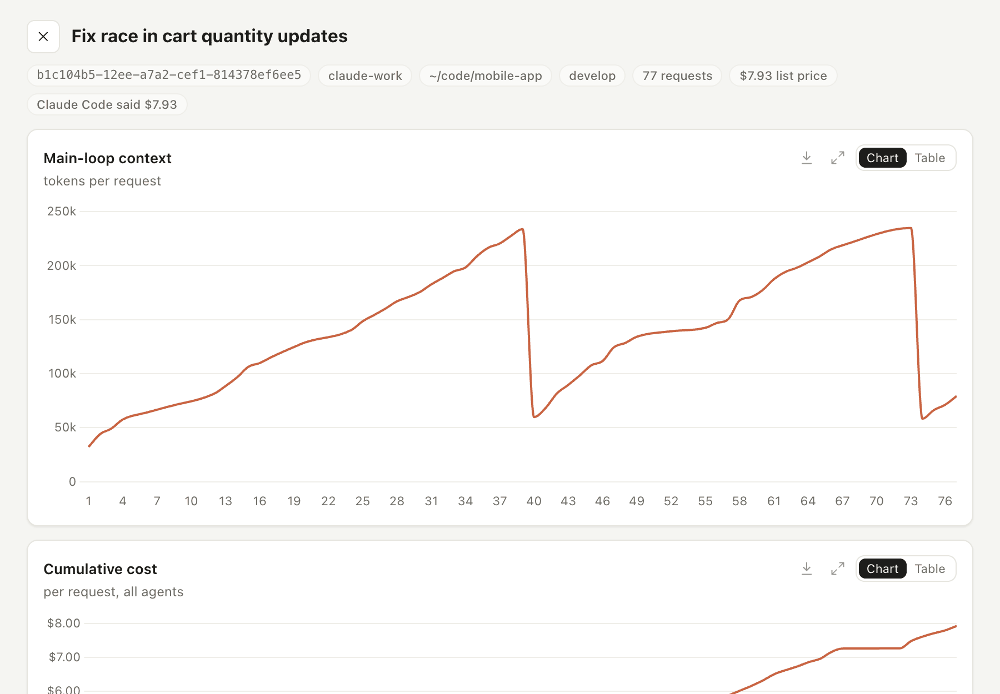

**Prompts.** Prompts per day, slash commands, and the most expensive prompts (every request until the next prompt is charged to it).

**Engine.** Time to first token and latency by model, tool latency, and the size of tool schemas and system prompt sections.

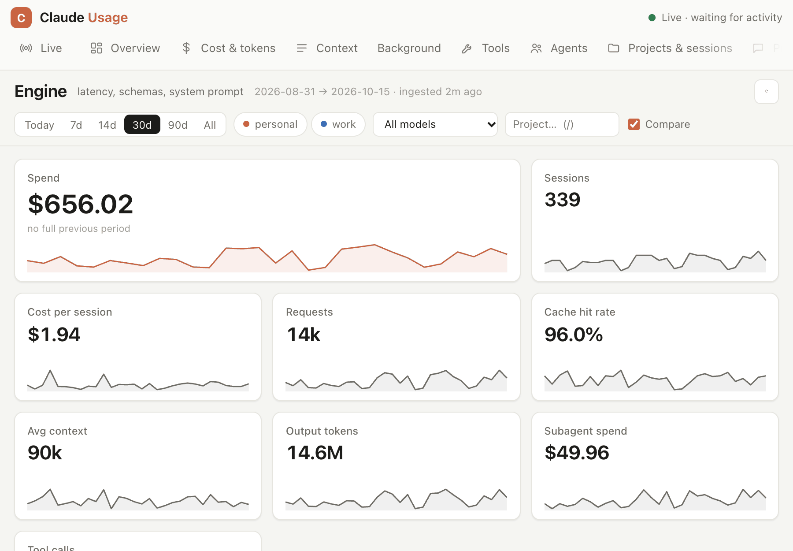

**Frustration.** How annoyed the prompts read: the score per day and week, when it boils over, what sets it off, and by model and project.

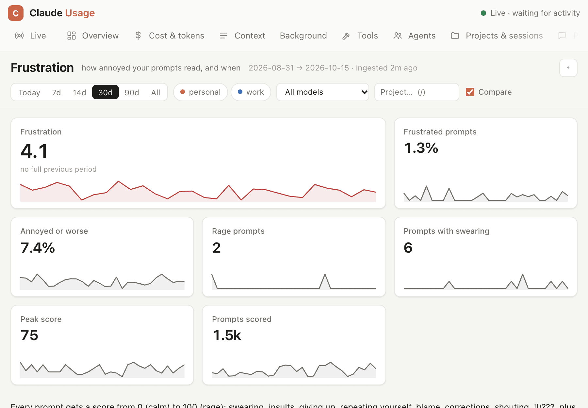

**Mod impact.** The holdout comparison for each mod; see [mod-impact.md](mod-impact.md).

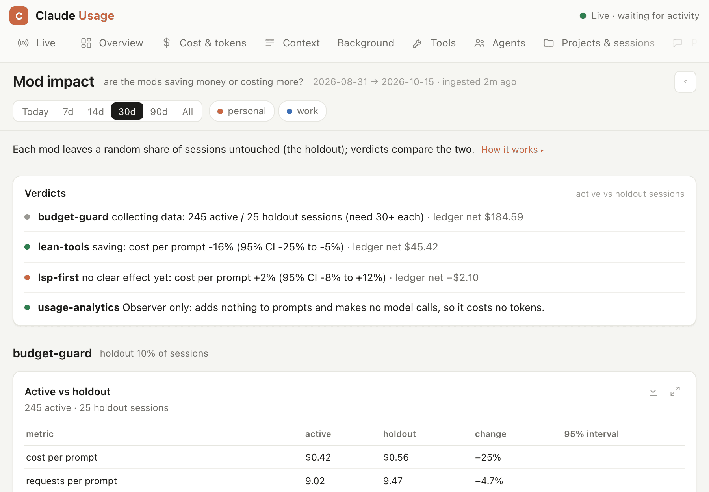

**Savings.** budget-guard's ledgers: dollars saved by lever, per day against spend, and per profile.

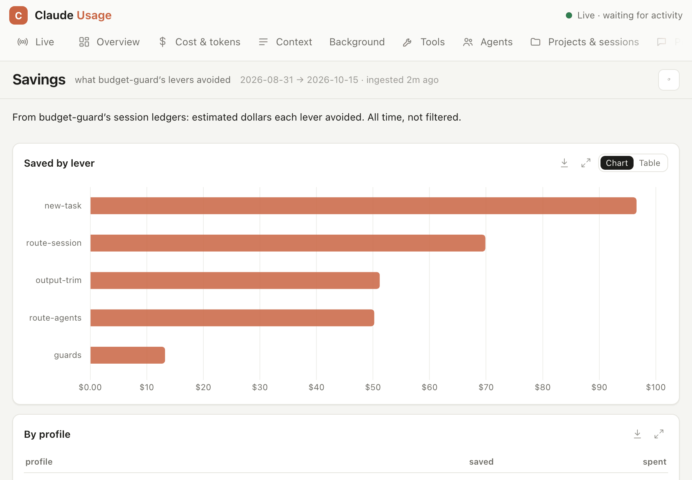

**Command palette** (<kbd>⌘K</kbd>): jump to a tab, set the period, pick profiles, run an ingest.

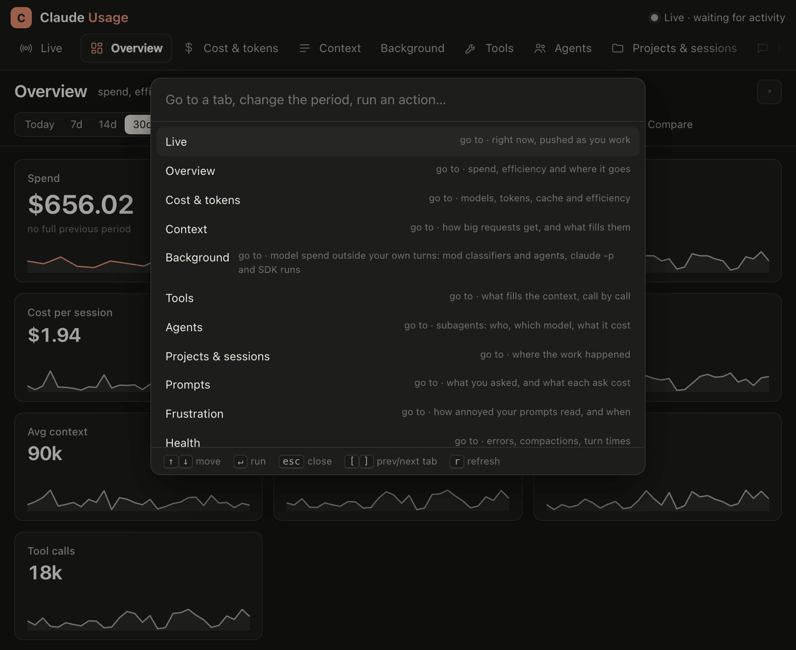

## Database

| Table | One row per |
| --- | --- |
| `requests` | API request (deduped by message id): profile, session, agent, ts/day/hour, project, branch, version, entrypoint, model, effort, stop reason, speed, token counts, `cost_usd` |
| `tool_uses` | Tool call: tool, input chars, file/ext, `cmd` (first two words of the real command, wrappers unwrapped), pattern, subagent, skill, MCP server, detail, result chars/images, error, `verify` (test/typecheck/lint/build), `flag` (fail/rejected/denied), `lines_out`, `wrote` and `replaced` (hashes of the lines an edit writes and replaces) |
| `prompts` | User-side message, by `kind`: prompt, interrupt, command, command_output, shell, notification, compact_summary, agent_prompt, meta. Text is kept. |
| `attachments` | Injected context (reminders, skill listings, file snapshots…), with size |
| `system_events` | turn_duration, compact_boundary, api_error, … |
| `sessions` | Title, Claude Code's own cost, API/tool ms, lines added/removed |
| `agents` | Subagent: type, description, parent, spawn depth |
| `events` | Raw mod events, as JSON |
| `git_outcomes` | Session with edits: state (done, pending, no_repo), repos, files edited and committed, lines written and kept at the next commit, commits |
| `gateway_spend` | Day and model billed by a LiteLLM gateway (see *Gateway spend*) |
| `files`, `meta` | Ingest bookkeeping |

**Views:** `v_requests` (adds `context_tokens` and `agent_type`), `v_background` (the mods' own model calls: requests from their claude -p runs and agents plus budget-guard's in-session calls, with `caller`, `kind` and `run_id`), `v_mod_steps`, `v_mod_tools`, `v_context`, `v_measure`, `v_compactions`, `v_tool_schemas`, `v_system_prompt`.

**Cost.** `cost_usd` is the list price from `<mods home>/usage-analytics/pricing.json`. Models are matched by substring, longest key first; fast mode is ×2. After editing the file, run `claude-usage reprice`. Gateway (LiteLLM) billing can differ, so it is kept next to it, never mixed in.

**Gateway spend.** On a LiteLLM gateway (`ANTHROPIC_BASE_URL` not anthropic.com), the mod reads `/user/daily/activity` with the session's own token about 20s after session start. It writes what LiteLLM billed per day and model (spend, requests, tokens) to `<data>/gateway/<profile>.json`: back `gatewayMonths` (12) months the first time, then from the 1st of last month. The session's token and `ANTHROPIC_CUSTOM_HEADERS` are sent only to that gateway; only the host is kept, never the token. The import loads it into `gateway_spend` (profile, day, model, spend_usd, requests, input, output, cache_read, cache_write). `claude-usage report gateway` compares it with the list-price estimate per day; the dashboard shows it as a "billed by the gateway" tile. Set `gatewayMonths` to 0 to turn it off.

## Config: `<mods home>/usage-analytics/config.json`

`<mods home>` is `$CLAUDE_MODS_HOME`, else `~/.claude-shared` if that folder exists (older installs), else `~/.claude-mods`. The mod writes the file complete with defaults on first run and adds new keys later; edit it and the change applies from the next session (the CLI reads `port` at once).

Environment: `CLAUDE_MODS_HOME` (above); `CLAUDE_USAGE_DIR` replaces `<mods home>/usage-analytics` as the data folder, for the CLI and the mod; `CLAUDE_USAGE_PORT` overrides `port` for the CLI. `claude-usage path` prints the data folder.

| Key | Default | Meaning |
| --- | --- | --- |
| `storePrompts` | true | keep prompt text in the event log |
| `maxInputChars` | 4000 | tool input chars kept per event |
| `maxResultChars` | 0 | tool result chars kept (0 = size only) |
| `maxAnswerChars` | 2000 | assistant answer chars kept |
| `breakdownEvery` | 3 | `/context` breakdown every N main turns |
| `autoIngest`, `ingestEveryMin` | true, 30 | background ingest: first 45s after session start, then every N minutes (minimum 5) |
| `captureOtel` | true | also log Claude Code's own telemetry events |
| `dashboard` | true | keep the one dashboard server running (started at session start and by `/analytics`) |
| `port` | 8787 | dashboard port (127.0.0.1 only) |
| `advisorModel` | `sonnet` | the model `/analytics advise bg` and `/analytics recurring classify bg` run on |
| `advisorNotify` | true | toast (90s into an interactive session) when an applied recommendation gets a verdict |
| `weeklyDigest` | true | once per ISO week, two minutes into an interactive session, a toast with last week's digest |
| `gitOutcomes` | true | the import runs `git log`/`git show` in the repos you edited, to see what was committed; false turns it off |
| `gatewayMonths` | 12 | on a LiteLLM gateway: months of billed spend to copy the first time; 0 turns the sync off |
| `profileDirs` | `[]` | config dirs to read transcripts from; empty = auto: `~/.claude*` plus every config dir a session registered under `profiles/` |

## Files

- `usage-analytics/hooks/register.ts`: the collector. Events are buffered and flushed every 15s, at 400 events, and at session end. It also registers `/analytics` and `/dashboard`.
- `usage-analytics/bin/claude-usage`: ingest, report, sql, export and serve.
- `usage-analytics/bin/dashboard_api.py`: the dashboard server and its queries.
- `usage-analytics/bin/impact.py`: the mod impact analysis.
- `usage-analytics/bin/recurring.py`: the recurring-ask detection, labels and statuses (`recurring.db`).
- `usage-analytics/bin/advisor.py`: the advisor's metrics, findings, verdicts and store (`advisor.db`).
- `usage-analytics/dashboard/index.html`: the page.
- `usage-analytics/tests/usage-analytics.test.ts`: event paths, ordering, facets, and a check that no secret leaks.
- Data lives in `<mods home>/usage-analytics/` (or `$CLAUDE_USAGE_DIR`): `usage.db`, `events/`, `pricing.json`, `config.json`, `profiles/<profile>.json` (registered config dirs), `advisor.db`, `recurring.db`, `recurring-runs/`, `advisor-runs/` (each research run's raw result), `dashboard.log`, `dashboard.lock`, `ingest.lock`, `live/<profile>.json` (activity pulses), `gateway/<profile>.json` (billed spend), `summaries/`, `cli-path`.

## Secrets

Before anything is written, the mod (event files) and the ingester (`usage.db`) blank anything that looks like a credential: API keys (`sk-…`, `ghp_…`, AWS, Slack), JWTs, `Bearer`/`Basic` values, `*TOKEN*=`/`*SECRET*:`/`--password=` values, URL passwords, private keys, and string values under keys such as `apiKey` or `authorization`. `claude-usage scrub` applies the same redaction to data stored earlier (DB rows and event files) and vacuums the DB. Claude Code's own transcripts in `~/.claude*/projects` are untouched.

## Troubleshooting

- **Dashboard shows old data:** click *Ingest now*, or run `claude-usage ingest`.
- **Port in use:** set `port` in the config (or run `/analytics setup`), or `CLAUDE_USAGE_PORT` for the CLI.
- **Stop the dashboard:** `/analytics stop` or `claude-usage stop`. It comes back at the next session start unless `"dashboard": false`. After a mod update, the next session start replaces an older running server by itself.
- **Sidebar says "reconnecting…":** the server stopped. Any `/analytics` command or new session starts it again, and the page reconnects on its own.
- **Open on a tab:** `http://127.0.0.1:8787/#impact`.
- **Engine tab empty:** only sessions started after the mod was installed have mod events. Restart old sessions.
- **Numbers look doubled after a format change:** `claude-usage ingest --full`.
