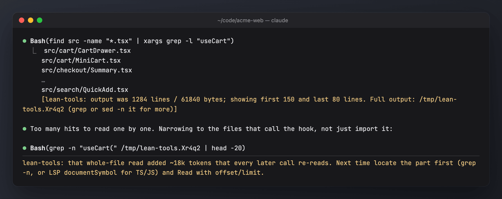

# lean-tools

Makes tool output smaller and round trips fewer. Every tool call re-sends the whole context, and every character a tool returns stays in context until compaction. lean-tools caps huge shell output, bounds `git log`, and nudges the model toward batched calls, ranged reads and Edit over Write.

- **Bash output cap:** output over 24 KB or 400 lines is cut to the first 150 and last 80 lines. The full output stays in a temp log the model can grep. Exit codes, `cd`, env and heredocs keep working.
- **Leaves bounded commands alone:** pipes to head/tail, ranged reads, heredocs, background runs and noisy build/test commands are left as they are. budget-guard trims those itself.
- **`git log` bound:** adds `-n 30` to a `git log` with no count, range or date limit.
- **System prompt guide:** five short rules: batch independent calls, search then read ranges, don't re-read, Edit over Write, keep output small.
- **Nudges:** a hidden note after 4 single read-only turns in a row, a whole-file Read over 30k chars, a re-read of an unchanged file, or a big Write to an existing file. Each kind fires at most once every 10 minutes.
- **Measured:** 20% of sessions are a holdout that only logs what it would have done. `/analytics impact` says whether the mod pays off.



The screenshots use generated demo data ([scripts/demo](../scripts/demo/README.md)).

## Install

```sh
sh bin/mods install --only lean-tools     # every profile on this machine; or, in Claude Code:
/plugin install lean-tools@my-mods
```

Everything is on after install, with no setup.

## Commands

| Command | Effect |
| --- | --- |
| `/lean` · `/lean status` | on, off or paused; this session's arm (active or holdout); settings; this session's caps, nudges and bounded `git log`s |
| `/lean setup` | a short wizard that writes config.json |
| `/lean off [30m\|2h\|1d\|session]` | pauses the mod for that long; with no duration, off until `/lean on` |
| `/lean on` | turns it back on and ends any pause |
| `/lean holdout <0-1>` | the share of passive sessions (from the next session) |
| `/lean cap\|nudges\|guide on\|off` | switches that part |

## Config

`<mods home>/lean-tools/config.json`: `enabled`, `holdout` (0.2), `capOutput`, `maxBytes` (24000), `maxLines` (400), `headLines` (150), `tailLines` (80), `boundGitLog`, `nudges`, `streak` (4), `bigRead` (30000), `guide`. Changes apply from the next session.

Full documentation: [docs/lean-tools.md](../docs/lean-tools.md).
