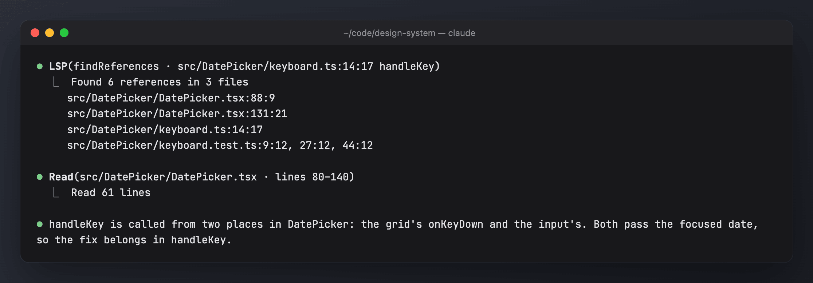

# lsp-first

Gets the model to answer symbol questions with the language server instead of grepping and reading whole files. Without it the LSP tool is deferred and, in practice, rarely called: one setup measured 0 LSP calls against about 15k grep/rg/find searches.

- **LSP tool up front:** keeps the LSP tool's schema in the tool list instead of behind ToolSearch, so using it costs no extra round trip.
- **System prompt guide:** when the LSP tool is present, a short guide maps each question to an operation: `goToDefinition` / `workspaceSymbol` for definitions, `findReferences` and call hierarchy for callers, `hover` for types, `documentSymbol` for a file's outline. grep stays the tool for strings, comments, config and non-TS/JS files.
- **Nudges:** when `grep`, `rg`, `git grep` or `ag` searches TS/JS for a bare identifier, the result carries a one-line hint naming the LSP operation to use, at most once every 10 minutes.
- **Does nothing without a language server:** with no LSP plugin installed, nothing changes.
- **Measured:** 20% of sessions are a holdout that stays passive. `/analytics impact` says whether the mod pays off.



The screenshots use generated demo data ([scripts/demo](../scripts/demo/README.md)).

## Install

```sh
sh bin/mods install --only lsp-first     # every profile on this machine; or, in Claude Code:
/plugin install lsp-first@my-mods
```

It needs a language server plugin. For TypeScript/JavaScript:

```sh
npm i -g typescript-language-server typescript
```
```
/plugin install typescript-lsp@claude-plugins-official
```

`/mods doctor` checks for `typescript-language-server`.

## Commands

| Command | Effect |
| --- | --- |
| `/lsp-first` · `/lsp-first status` | on, off or paused; this session's arm; settings; this session's LSP calls, TS/JS symbol searches and nudges |
| `/lsp-first setup` | checks for the LSP tool, asks about the options and writes config.json |
| `/lsp-first off [30m\|2h\|1d\|session]` | steps aside for that long; with no duration, off until `/lsp-first on` |
| `/lsp-first on` | turns it back on and ends any pause |
| `/lsp-first holdout <0-1>` | the share of passive sessions (from the next session) |
| `/lsp-first nudges\|guide on\|off` | switches that part |

## Config

`<mods home>/lsp-first/config.json`: `{ "enabled": true, "holdout": 0.2, "upfront": true, "guide": true, "nudges": true }`. Changes apply from the next session.

Full documentation: [docs/lsp-first.md](../docs/lsp-first.md).
