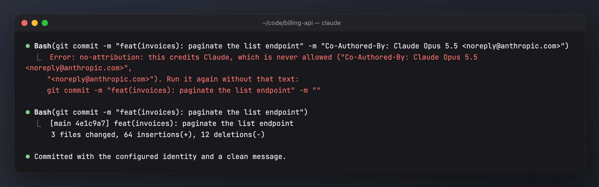
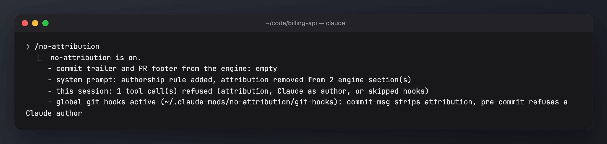

# no-attribution

Claude never credits itself: no `Co-Authored-By: Claude …` trailer, no "🤖 Generated with Claude Code" footer, no `noreply@anthropic.com`, and no commits with Claude as author or committer. This holds in commits, PR and issue bodies, code, docs and every tool call.

- **Engine attribution off:** the engine's commit trailer and PR footer come back empty, whatever `settings.json` says.
- **System prompt rule:** attribution lines are removed from the engine's prompt sections and skill prompts, and a rule tells the model it is never an author anywhere.
- **Refused, never rewritten:** a Bash command, Write/Edit/NotebookEdit text or MCP tool argument that carries attribution is refused, so what runs is exactly what you approved. For Bash the refusal includes the clean command, and the model sends that instead.
- **No Claude author, no skipped hooks:** `--author`, `GIT_AUTHOR_*`, `git config user.name` as Claude, `--no-verify` and `core.hooksPath` overrides are refused too.
- **Global git hooks:** `commit-msg` strips attribution from every commit message, whoever wrote it, and `pre-commit` refuses a Claude author. Each one then runs the repository's own hook.
- **Always on:** there is no pause. Only the git hooks can be switched off.





The screenshots use generated demo data ([scripts/demo](../scripts/demo/README.md)).

## Install

```sh
sh bin/mods install --only no-attribution     # every profile on this machine; or, in Claude Code:
/plugin install no-attribution@my-mods
```

The git hooks are installed at the first session start, unless another global `core.hooksPath` is already set (then they are left alone, with a toast).

## Commands

| Command | Effect |
| --- | --- |
| `/no-attribution` · `/no-attribution status` | the layers, what was refused this session, the git hook state; reinstalls missing hooks |
| `/no-attribution setup` | asks whether to install the global git hooks and writes config.json |
| `/no-attribution hooks on\|off` | installs the global git hooks, or removes them (only if they are this mod's) |

## Config

`<mods home>/no-attribution/config.json`: `{ "gitHooks": true }`. Optionally, also set `attribution: { commit: "", pr: "", sessionUrl: false }` and `includeCoAuthoredBy: false` in your `settings.json`.

Full documentation: [docs/no-attribution.md](../docs/no-attribution.md).
