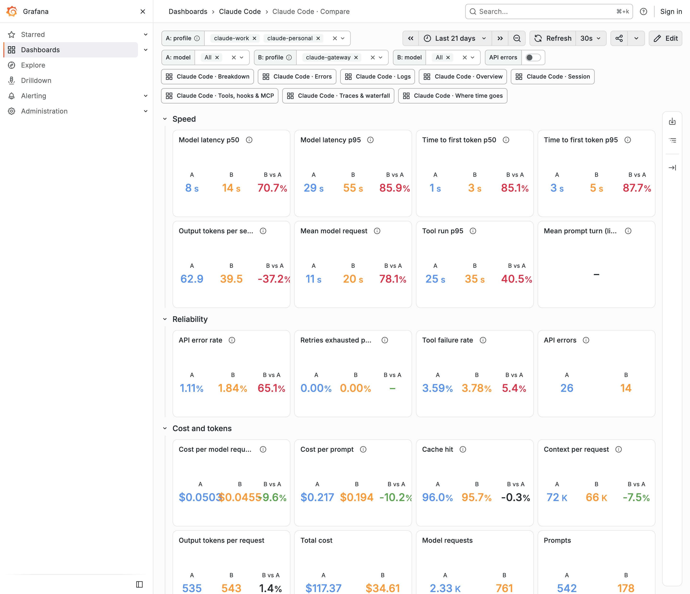
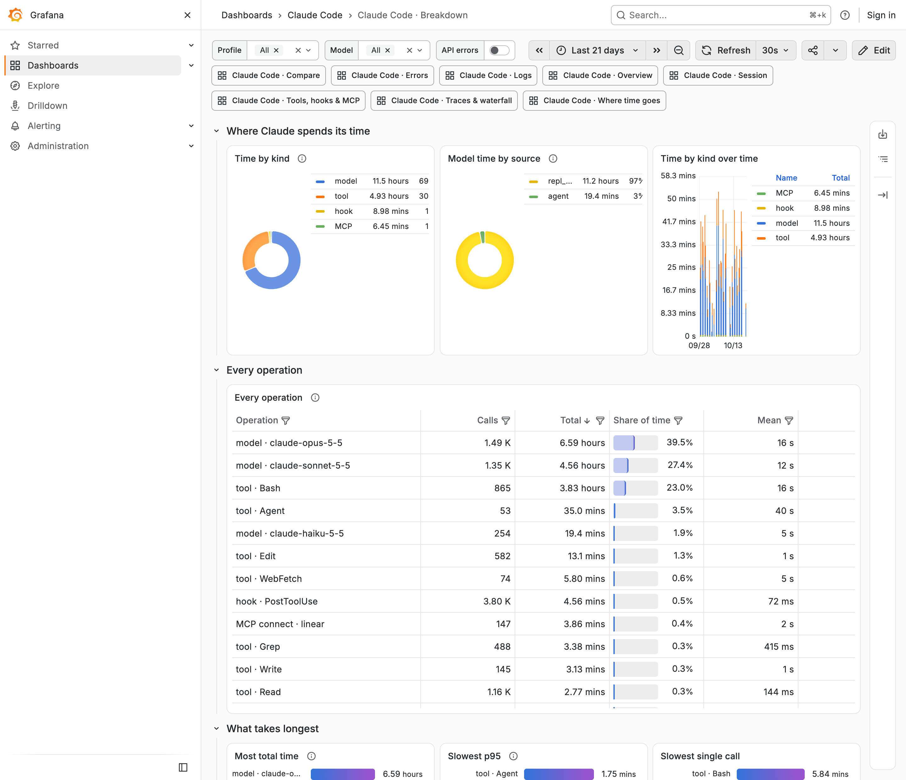
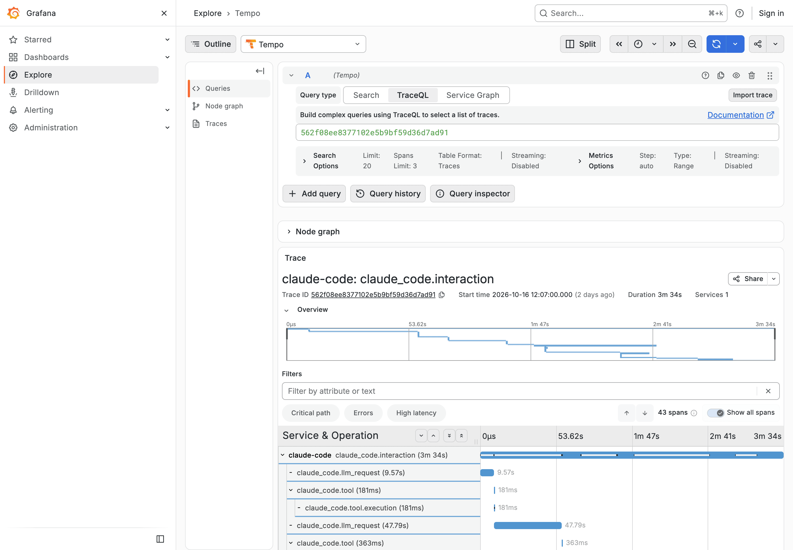
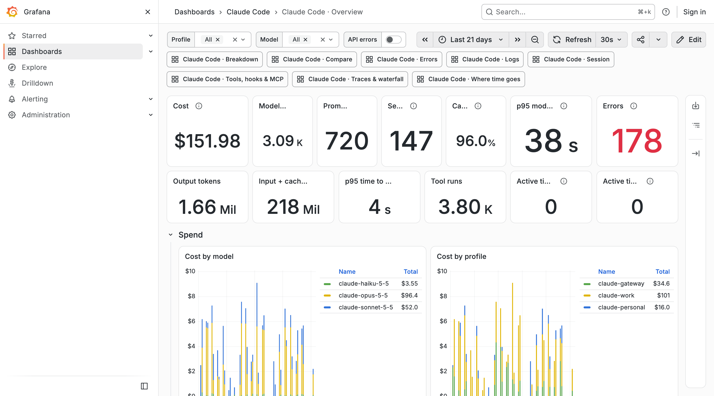
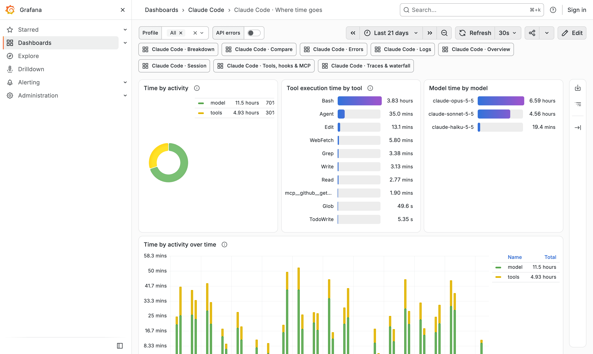

# observability

A free, local observability platform for Claude Code. Every profile (`~/.claude`, each `~/.claude-*`) sends Claude Code's own OpenTelemetry metrics, events and traces to one Grafana stack on this machine. Its dashboards show where time goes, where errors happen and what each session cost. Every prompt opens as a trace waterfall, and two sets of profiles can be compared side by side, for example the subscription against a LiteLLM gateway.

- **Free and local only:** the open-source grafana/otel-lgtm image (Grafana, Tempo, Loki, Prometheus) in one container, pinned to a fixed version. Every port is bound to `127.0.0.1`, usage reporting and update checks are off, and nothing leaves the machine.
- **On by default:** the telemetry env goes into every profile's `settings.json` at the next session start, tagged `claude.profile=<profile>`. The stack starts in the background when Docker runs, and data is kept 90 days.
- **Compare:** side A against side B, each a set of profiles and models. Every figure shows as A, B and "B vs A" in percent: latency, time to first token, tokens per second, error, retry and tool failure rates, cost per request and per prompt, and per model, tool, operation and event.
- **Breakdown:** every event and every timed operation (each model, tool, hook event, MCP server) in one table, with calls, total time and share, p50, p95, max and failure rate. It shows what takes longest and what fails most.
- **Traces:** each prompt as a waterfall: prompt → model calls → tools → hooks, with subagents nested under the Agent call that ran them.
- **History:** `claude-obs backfill` replays past transcripts as traces and events, so dashboards cover sessions from before the install.
- **Safe with other setups:** it only changes the settings keys it wrote, and leaves a profile that already sends OpenTelemetry elsewhere alone.



| | |
| --- | --- |
|  **Breakdown**: every operation on one scale |  **Traces**: one prompt as a waterfall |
|  **Overview**: spend, requests, latency, errors |  **Where time goes**: model, tools and you |

The screenshots use generated demo data ([scripts/demo](../scripts/demo/README.md)).

## Install

Needs Docker; any free runtime works (on macOS `brew install colima docker && colima start`, or OrbStack).

```sh
sh bin/mods install --only observability     # every profile on this machine; or, in Claude Code:
/plugin install observability@my-mods
```

Telemetry takes effect from the next session in each profile. Grafana is at http://127.0.0.1:3301 and needs no login to browse.

## Commands

| Command | What it does |
| --- | --- |
| `/obs` · `/obs status` | stack state, Grafana URL, data size and retention; per profile whether telemetry is on |
| `/obs open [overview\|traces\|time\|errors\|logs\|sessions\|tools\|compare\|breakdown\|explore]` | opens Grafana on that dashboard |
| `/obs up` · `/obs down` | starts (or replaces an outdated) stack · stops it; data is kept |
| `/obs backfill [--days N] [--profile P] [--dry-run]` | replays past transcripts as traces and events |
| `/obs telemetry on\|off [all]` | writes or removes the telemetry env in this profile, or in every profile |
| `/obs content on\|off` | keep or drop prompt text, commands and paths |

The same from a shell: `<plugin>/bin/claude-obs up|down|status|open|logs|backfill|reset confirm|env`.

## Config

`<mods home>/observability/config.json`: `telemetry`, `content` (on), `toolContent` (off), `detailedTracing`, `autostart`, the three ports and `retentionDays` (90).

Full documentation: [docs/observability.md](../docs/observability.md).
