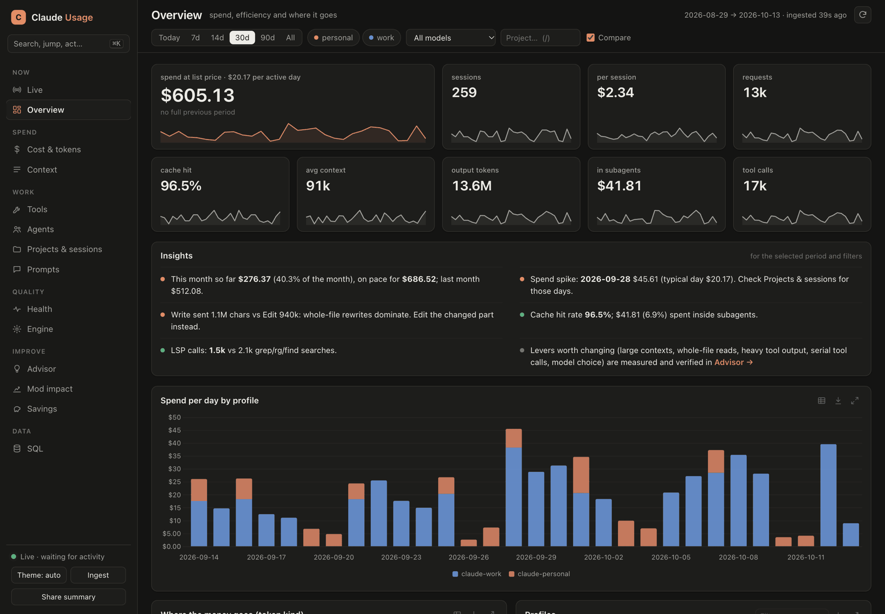
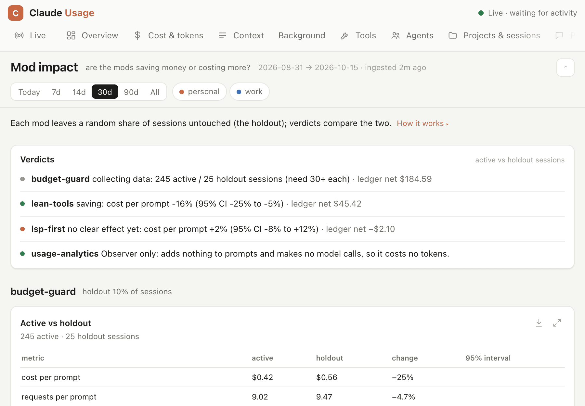
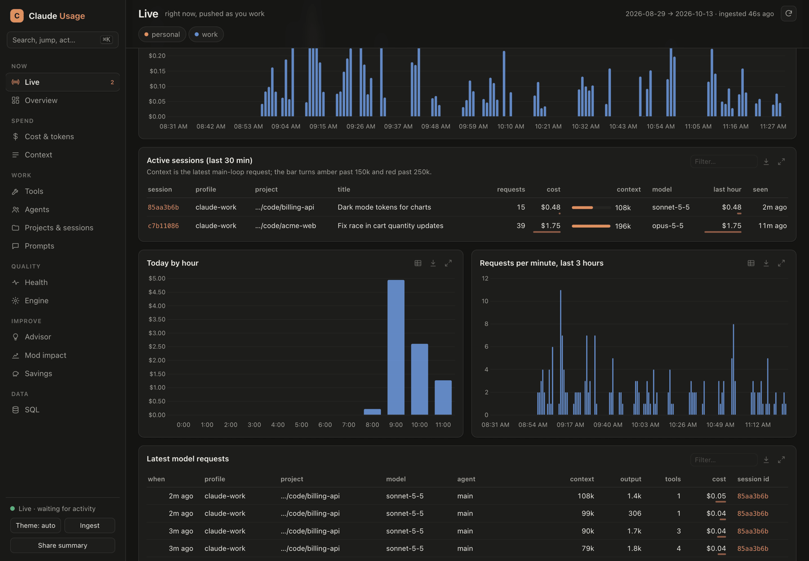
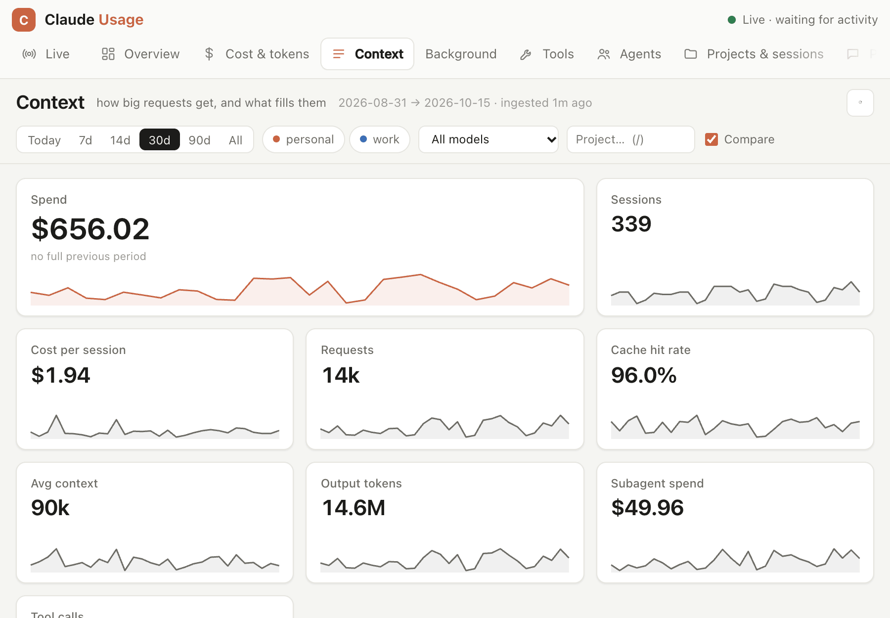
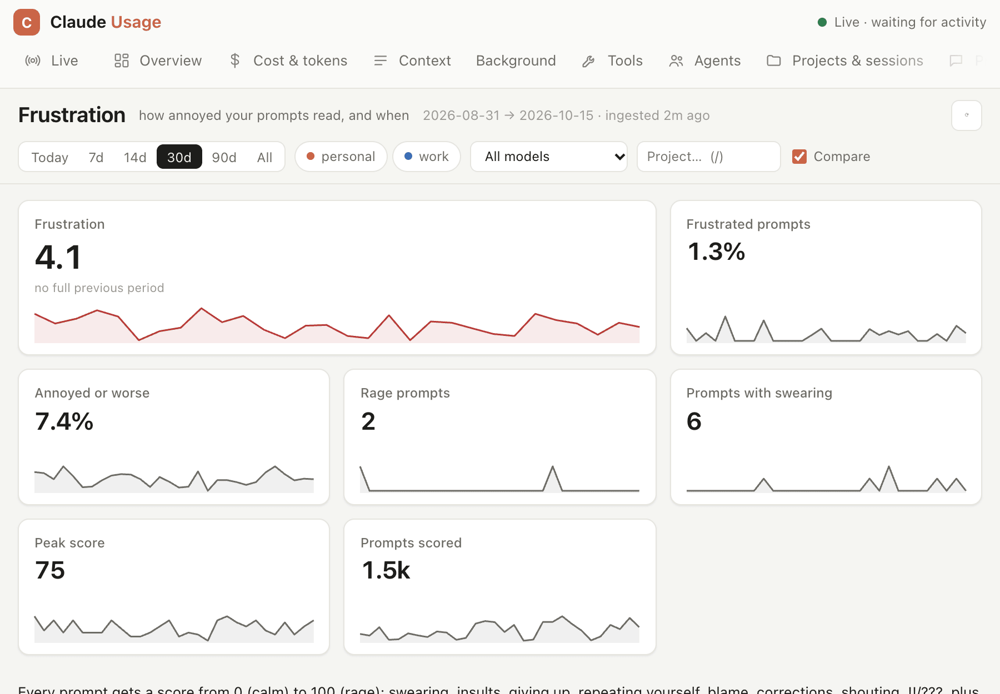
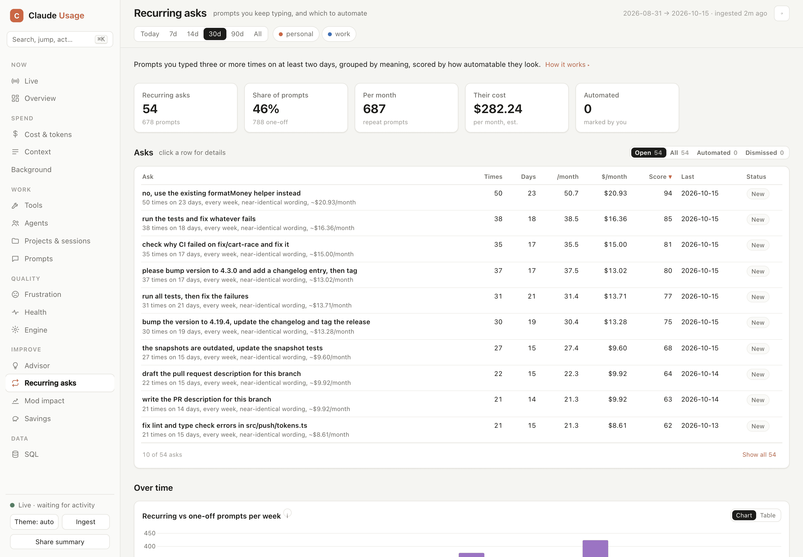
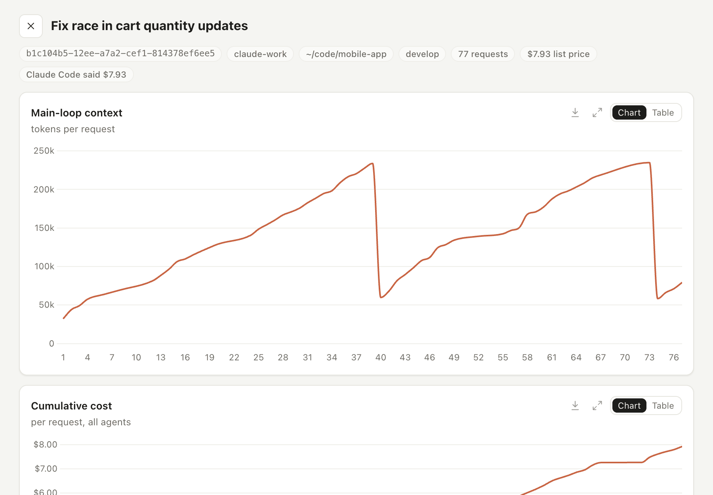

# usage-analytics

One local store of how every profile spends tokens, with a live web dashboard and a terminal report. It reads every transcript on disk (all history, subagents included) and its own event log, which adds what transcripts lack: time to first token, tool latency, the `/context` breakdown, system prompt and tool schema sizes, rate limits and compactions.

- **Dashboard:** http://127.0.0.1:8787, one server per machine, updated within about a second of any activity. Tabs for live sessions, overview, cost, context, tools, agents, projects, prompts, frustration, health, engine internals, mod spend, the advisor, recurring asks, mod impact, savings and SQL.
- **Full history from day one:** the first start imports every transcript already on disk, for `~/.claude` and every `~/.claude-*` profile.
- **Mod impact:** each mod that changes what the model does runs a holdout. The Mod impact tab says whether it saves money or costs more, with 95% intervals.
- **Advisor:** on request, researches how to use Claude cheaper, faster and more reliably from your own data, then measures each change you apply.
- **Output quality and frustration:** corrections, interrupts, rejected calls, check pass rate and lines kept at commit, so a cheaper setup can be shown to give results as good. Every prompt also gets a frustration score.
- **Recurring asks:** finds the prompts you keep typing and drafts a skill, hook or command for each.
- **Local and redacted:** SQLite in the mods data folder, served on 127.0.0.1 only, secrets redacted. Your data is sent nowhere; the only outside requests are the dashboard page loading Chart.js from jsDelivr and, on a LiteLLM gateway, the spend sync.



| | |
| --- | --- |
|  **Mod impact**: each mod against its holdout |  **Live**: the sessions running now |
|  **Context**: what fills the window |  **Frustration**: how each prompt reads |
|  **Recurring**: asks worth automating |  **Session drill-down**: every request of one session |

The screenshots use generated demo data ([scripts/demo](../scripts/demo/README.md)).

## Install

Needs Python 3 for the database and dashboard (stdlib only). Without it, events are still recorded.

```sh
sh bin/mods install --only usage-analytics     # every profile on this machine; or, in Claude Code:
/plugin install usage-analytics@my-mods
```

Everything is on after install. `/analytics setup` picks the profiles, whether prompt text is kept and when the dashboard runs.

## Commands

| Command | Effect |
| --- | --- |
| `/dashboard [tab]` | restarts the dashboard server and opens it, optionally on a tab; `/dashboard stop` closes it |
| `/analytics [overview\|daily\|models\|projects\|tools\|context\|quality\|frustration\|…] [--days N]` | terminal report |
| `/analytics impact` | are the mods saving money or costing more |
| `/analytics advise` · `advise bg` · `advise show` | the advisor, here or in the background · its findings |
| `/analytics recurring` · `recurring classify` | the prompts you keep typing · drafts an automation for each |
| `/analytics digest` · `/analytics summary` | last week against the week before · a shareable summary with no prompts or code |
| `/analytics setup` · `status` · `ingest` | the wizard · data and server status · import now |

From a shell: `usage-analytics/bin/claude-usage ingest|report|serve|stop|sql|export|impact|advise|recurring|autostart …`.

## Config

`<mods home>/usage-analytics/config.json`: `storePrompts` (true), `maxResultChars` (0, size only), `port` (8787), `dashboard` (true), `dashboardIdleMin` (60), `autoIngest` and `ingestEveryMin` (30), `captureOtel`, `gitOutcomes`, `advisorModel` (sonnet), `weeklyDigest`, `advisorNotify`, `gatewayMonths` (12), `profileDirs`. Changes apply from the next session.

Full documentation: [docs/usage-analytics.md](../docs/usage-analytics.md) and [docs/mod-impact.md](../docs/mod-impact.md).
